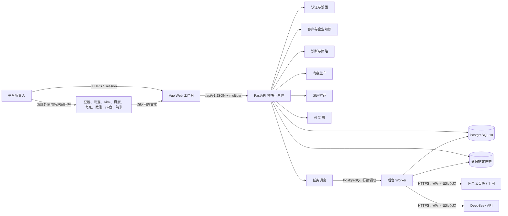
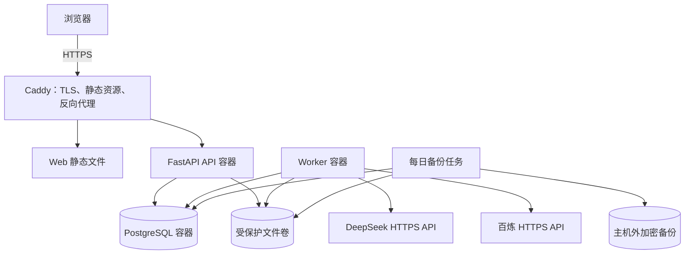
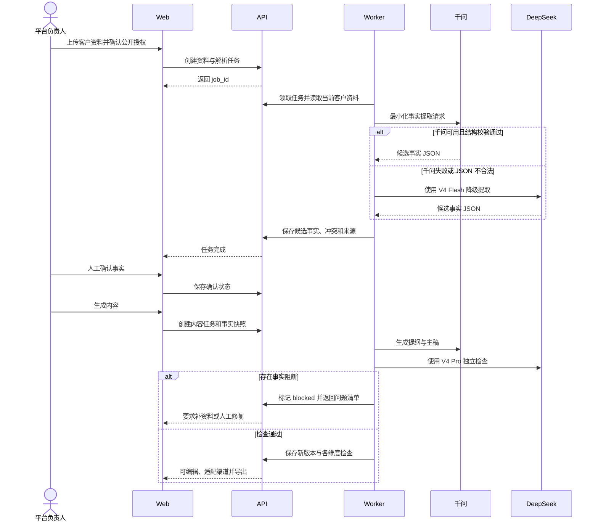

# 本地服务 GEO 内容策略与生产平台 PRD

Status: 阶段 C 定稿完成，开发尚未开始  
版本：1.0-final  
更新时间：2026-07-27

## 1. 背景与目标

本产品是一套由平台负责人单人使用的本地服务 GEO 代运营工作台。客户第一版不登录，只提交企业资料并接收代运营结果。

V1 客户端形态仅为 Web 网页版，通过现代桌面浏览器访问。网页保留基础宽度适配，但不为平板或手机单独设计功能，也不开发 Windows/macOS 安装包、微信小程序、iOS/Android App 或其他客户端。

系统的核心任务不是单纯批量写文章，而是将以下 GEO 工作方法产品化：

1. 将客户资料整理成统一、可信、可验证的企业实体。
2. 判断消费者会使用哪些“地区 + 服务 + 人群 + 意图 + 场景”查询。
3. 根据实体缺口、内容缺口、来源缺口和平台生态决定先写什么。
4. 使用 DeepSeek 与通义千问生成事实可靠、便于搜索与引用的内容。
5. 通过选择性的中文自然化处理减少明显 AI 写作痕迹。
6. 推荐适合客户的免费和付费渠道，由使用者线下人工发布。
7. 监测国内主要 AI 平台是否在无品牌词问题中发现客户、正确关联客户并在推荐问题中将其列为候选，再反向调整下一轮策略。

产品不承诺固定排名、必然收录或必然被 AI 推荐。

### 1.1 北极星结果

产品的最终业务目标是：当消费者在 DeepSeek、豆包等主流 AI 平台询问某地区的某类本地服务时，客户企业能够在回答中被正确识别；当消费者继续提出“推荐一家”“哪家适合我”等决策问题时，客户有机会作为具备真实理由的候选企业出现。

系统用四级结果阶梯管理这一目标：

| 级别 | 目标 | 示例 | 判断标准 |
|---|---|---|---|
| L1 被发现 | 无品牌词问题中出现客户名称 | “即墨有哪些少儿美术培训？” | 回答出现“莱恩美术”，且问题本身没有客户名称 |
| L2 被正确理解 | 客户与地区、服务和客群关系正确 | “莱恩美术—即墨—少儿美术培训” | 核心实体关系和企业事实与知识库一致 |
| L3 进入推荐候选 | 推荐类问题中客户作为候选出现 | “即墨少儿美术推荐一家” | 回答明确把客户列为可考虑对象，并给出可核实理由 |
| L4 可重复出现 | 多次、跨时间或跨平台复测仍能出现 | 同一问题多次采样 | 显示样本数和波动，不以一次回答宣称稳定成功 |

所有诊断、关键词、问题、内容和渠道建议必须标明主要服务于 L1—L4 中的哪一级；如果某一级未达到，系统应给出下一轮可执行动作，而不是只报告一个分数。

## 2. 用户与权限

### 2.1 直接用户

- 平台负责人：唯一系统用户，管理全部客户、策略、内容、渠道建议和监测结果。

### 2.2 服务客户

- 中国大陆本地生活与本地服务行业的中小企业。
- 客户第一版没有系统账号，不进入后台。
- 首个试点行业为少儿美术培训，示例客户为即墨“莱恩美术”。

### 2.3 权限边界

- 首版只有一个负责人账号。
- 不建设管理员、运营、审核员等多角色。
- 不建设审批流、权限分组和客户账号。
- 数据访问默认仅限负责人。

## 3. 页面清单与跳转逻辑（A1 已确认）

P00 是安全入口，不计入 8 个业务页面。

| 序号 | 页面名称 | 页面类型 | 可见用户 | 入口来源 | 主要跳转去向 |
|---|---|---|---|---|---|
| P00 | 负责人登录 | 表单页 | 未登录负责人 | 直接访问 | P01 客户列表 |
| P01 | 客户列表与工作台 | 列表/概览页 | 负责人 | 登录后、侧边栏 | P02、P03、P04、P05、P07 |
| P02 | 客户资料与企业知识库 | 详情/表单页 | 负责人 | P01、侧边栏客户切换器 | P03、P04、P05 |
| P03 | GEO 诊断与策略中心 | 诊断/仪表盘 | 负责人 | P01、P02、侧边栏 | P04、P06、P07 |
| P04 | 关键词、问题与内容计划 | 列表/规划页 | 负责人 | P03、侧边栏 | P05、P06 |
| P05 | 内容生成与优化工作台 | 编辑器 | 负责人 | P04、P01、侧边栏 | P06、P04 |
| P06 | 发布渠道库与分发建议 | 目录/推荐页 | 负责人 | P03、P04、P05、侧边栏 | 第三方官方平台 |
| P07 | 国内主流 AI 可见性监测 | 监测/分析页 | 负责人 | P01、P03、侧边栏 | P03、P04 |
| P08 | 模型、规则和行业模板设置 | 设置页 | 负责人 | 侧边栏底部 | 返回原页面 |

### 3.1 全局布局

- P01—P08 使用统一左侧导航。
- 顶部提供当前客户切换器；P02—P07 必须明确显示当前客户。
- 未选择客户时，P02—P07 显示客户选择提示，不混用不同客户数据。
- 顶部显示全局搜索、当前账号和退出入口。
- 首版不提供消息中心、审批待办和角色切换。

### 3.2 主业务跳转

详细流程见 [User-Flow.md](diagrams/User-Flow.md)。

```text
P00 登录
  → P01 选择或创建客户
  → P02 补全企业事实
  → P03 生成 GEO 诊断
  → P04 形成关键词、问题与内容计划
  → P05 生成、优化并导出内容
  → P06 查看渠道建议并人工发布
  → P07 复测 AI 可见性
  → P03/P04 调整下一轮策略
```

## 4. 主要功能定义与分析（A2）

### 页面：P00 负责人登录

#### 功能清单

| 功能编号 | 功能名称 | 一句话描述 | 用户可感知的完成标准 |
|---|---|---|---|
| F-00-01 | 账号密码登录 | 使用唯一负责人账号进入系统 | 正确输入后进入 P01；错误时显示明确原因 |
| F-00-02 | 保持登录状态 | 在安全有效期内保持会话 | 刷新页面后无需重复登录；过期后返回登录页 |
| F-00-03 | 安全退出 | 主动结束当前会话 | 退出后无法通过返回按钮查看客户数据 |

#### 功能边界

| 功能编号 | 包含 | 不包含 |
|---|---|---|
| F-00-01 | 单一账号、密码校验、错误提示 | 注册、社交登录、客户登录、多角色登录 |
| F-00-02 | 单设备常规会话管理 | 复杂设备管理、企业单点登录 |
| F-00-03 | 清除当前会话 | 批量踢出其他设备 |

#### 与其他页面的关联

- 登录成功 → P01。
- 未登录访问 P01—P08 → P00。
- 修改密码位于 P08，不单独建设找回密码页面。

---

### 页面：P01 客户列表与工作台

#### 功能清单

| 功能编号 | 功能名称 | 一句话描述 | 用户可感知的完成标准 |
|---|---|---|---|
| F-01-01 | 客户列表 | 集中查看所有客户及当前 GEO 阶段 | 每行显示企业名、地区、行业、资料完整度、策略状态、最近内容和最近监测时间 |
| F-01-02 | 搜索与筛选 | 按企业名、地区、行业和状态定位客户 | 输入或选择条件后列表即时显示匹配客户 |
| F-01-03 | 创建客户 | 建立新的客户工作空间 | 填写企业名称、地区和行业后生成客户并进入 P02 |
| F-01-04 | 客户概览 | 展示当前客户最重要的进展和问题 | 进入客户后看到事实完整度、内容覆盖、渠道覆盖、AI 提及概况和风险提示 |
| F-01-05 | 下一步建议 | 根据缺口推荐当前最值得执行的动作 | 系统展示 1—3 项带原因的行动，如“先补地址证据”或“生成品牌基础页” |
| F-01-06 | 归档客户 | 将暂停服务的客户移出活跃列表 | 归档前确认；归档后可从归档列表恢复 |

#### 功能边界

| 功能编号 | 包含 | 不包含 |
|---|---|---|
| F-01-01～02 | 单人管理所需的列表、搜索和筛选 | 团队分配、负责人、审核状态、销售管道 |
| F-01-03 | 最小建档和后续资料补全 | 客户自助注册、合同、订单、套餐 |
| F-01-04～05 | 可解释概览和下一步建议 | 只展示一个不可解释的 GEO 总分 |
| F-01-06 | 可恢复归档 | 永久删除客户及其资料 |

#### 与其他页面的关联

- 点击客户 → P02。
- 点击资料、策略、内容或监测卡片 → 对应 P02、P03、P05、P07。
- 点击下一步建议 → 直接进入执行该动作的页面。

---

### 页面：P02 客户资料与企业知识库

#### 功能清单

| 功能编号 | 功能名称 | 一句话描述 | 用户可感知的完成标准 |
|---|---|---|---|
| F-02-01 | 企业基础档案 | 维护企业标准名称、简称、地区、地址、电话、营业时间和官方渠道 | 保存后形成唯一“企业标准事实卡” |
| F-02-02 | 服务/产品与客群档案 | 维护真实服务或产品、适用客群、价格口径、服务范围和差异点 | 每个服务或产品可看到适用客群、地区和支持材料 |
| F-02-03 | 人员与能力证明 | 维护与交付有关的人员、经验事实、设备、授权、证照和可公开表述范围 | 系统区分“已验证”“客户提供”“不可公开”，没有人员或资质要求的行业可不填 |
| F-02-04 | 资料上传与提取 | 上传文档、图片和表格并提取候选事实 | 处理完成后展示提取结果，用户选择确认、修改或忽略 |
| F-02-05 | 事实与证据绑定 | 将宣传主张绑定到客户材料或可靠外部来源 | 每项关键主张可看到依据、来源日期和可公开状态 |
| F-02-06 | 缺失与冲突检查 | 发现资料缺项、前后矛盾和过期信息 | 页面明确列出冲突字段、涉及来源和建议处理方式 |
| F-02-07 | 实体一致性检查 | 比较客户已有官网、地图、本地生活或内容渠道中的名称、地址、电话等信息 | 仅检查实际存在或愿意配合的渠道；输出一致、不一致、未发现三种结果，不把未知当错误 |
| F-02-08 | 内容禁用规则 | 标记不得生成的说法、隐私资料和未经授权案例 | 后续生成内容时系统阻止或警告使用这些信息 |

知识库采用“行业通用核心 + 可选行业模板”。通用核心固定为企业主体、服务/产品与客群、人员与能力证明、资料与证据、渠道一致性和禁用规则；行业模板只能增加或重命名辅助字段，不得把“师资、课程、年龄”等教育字段设为所有客户的必填项。

#### 功能边界

| 功能编号 | 包含 | 不包含 |
|---|---|---|
| F-02-01～03 | 结构化企业事实和公开范围 | CRM、财务、排课、学员管理 |
| F-02-04 | 常见文档/图片提取、人工确认 | 未确认内容直接进入知识库 |
| F-02-05 | 主张与证据关系 | 伪造资质、案例、家长评价或数据 |
| F-02-06～07 | 缺失、冲突和跨渠道一致性提示 | 在第一版自动修改第三方平台资料 |
| F-02-08 | 内容生成安全边界 | 法律意见或替代人工合规判断 |

#### 与其他页面的关联

- 保存关键事实后 → 可在 P03 重新诊断。
- P03/P05 发现事实不足 → 返回 P02 对应字段。
- P05 引用客户事实时 → 可打开 P02 的证据详情。

---

### 页面：P03 GEO 诊断与策略中心

#### 功能清单

| 功能编号 | 功能名称 | 一句话描述 | 用户可感知的完成标准 |
|---|---|---|---|
| F-03-01 | 诊断范围设置 | 设置目标地区、服务、人群、品牌词和主要 AI 平台 | 页面清楚显示本次诊断覆盖范围和日期 |
| F-03-02 | 企业实体诊断 | 判断品牌与地区、服务、地址和联系方式的关联是否完整 | 输出具体缺失项、冲突项和对应修复建议 |
| F-03-03 | 内容覆盖诊断 | 判断客户是否覆盖品牌基础、服务说明、决策指南、问答、案例等内容 | 每类显示已覆盖、部分覆盖、未覆盖和依据 |
| F-03-04 | 来源与渠道诊断 | 判断企业在运营方内容平台、客户主体渠道和第三方可信来源中的覆盖 | 输出渠道所有权、公开可访问性、目标生态和建议优先级，不默认要求客户建设官网 |
| F-03-05 | AI 可见性基线 | 汇总 P07 的无品牌词发现、正确关联、推荐候选、事实准确和来源情况 | 可按平台、问题类型和 L1—L4 目标看到基线结果，不把单次回答当稳定排名 |
| F-03-06 | GEO 问题清单 | 将问题按影响、证据准备度和修复成本排序 | 每个问题显示原因、证据、建议动作和目标页面 |
| F-03-07 | 分阶段策略 | 生成“实体建立—无品牌发现—推荐理由—持续复测”行动方案 | 用户可看到每个阶段希望改善的 L1—L4 结果、推荐内容和渠道 |
| F-03-08 | 可解释诊断维度 | 分别显示实体完整、内容覆盖、来源覆盖和 AI 可见性 | 每个维度都能展开查看组成项，不只显示总分 |
| F-03-09 | 目标阶梯诊断 | 判断客户当前停留在 L1 被发现、L2 正确理解、L3 推荐候选或 L4 可重复出现的哪一级 | 每一级显示真实监测依据、缺口和下一步，不用主观“推荐潜力分”代替 |

#### 功能边界

| 功能编号 | 包含 | 不包含 |
|---|---|---|
| F-03-01 | 当前客户的目标市场范围 | 全国市场预测和自动扩张建议 |
| F-03-02～04 | 有依据的实体、内容、来源和渠道缺口 | 伪造平台收录、搜索量或竞争度 |
| F-03-05 | 来自真实监测样本的汇总 | 用 API 回答冒充消费者 App 真实结果 |
| F-03-06～09 | 可解释排序、结果阶梯和分阶段建议 | 保证收录、固定排名、保证推荐 |

#### 与其他页面的关联

- 点击事实问题 → P02 对应字段。
- 点击内容缺口或“生成计划” → P04。
- 点击渠道缺口 → P06。
- 点击 AI 可见性详情 → P07。

---

### 页面：P04 关键词、问题与内容计划

#### 功能清单

| 功能编号 | 功能名称 | 一句话描述 | 用户可感知的完成标准 |
|---|---|---|---|
| F-04-01 | 关键词生成 | 生成核心词、品牌词、决策词、服务词和真实地理长尾词 | 每个词显示类型、生成依据、适用内容和数据可信度 |
| F-04-02 | 用户问题生成 | 将关键词改写为消费者可能向 AI 提出的自然问题 | 问题包含目标地区、意图、适用人群、问题家族、目标阶梯和目标平台 |
| F-04-03 | 主题集群 | 将相近关键词和问题归入同一主题 | 用户可看到一个主主题覆盖哪些问题，减少重复写作 |
| F-04-04 | 关键词数据标记 | 区分实测、客户提供、系统推断和暂无数据 | 没有真实数据时不显示虚构搜索量或竞争度 |
| F-04-05 | 内容类型建议 | 为主题推荐品牌页、服务页、指南、FAQ、案例、活动或本地场景内容 | 推荐结果显示“为什么适合”和需要哪些事实 |
| F-04-06 | 选题优先级 | 按业务价值、查询相关度、证据准备度和渠道适配度排序 | 用户能展开查看每个优先级的组成原因 |
| F-04-07 | 内容计划 | 将选题加入计划并设置目标、内容类型、渠道和目标日期 | 列表可按阶段和内容状态查看，不需要团队任务分配 |
| F-04-08 | 内容简报 | 为每个选题生成写作目标、目标问题、必须使用事实、禁用说法和建议结构 | 打开选题即可看到可直接用于生成内容的完整简报 |
| F-04-09 | 人工编辑与锁定 | 允许修改、删除、合并关键词和问题，并锁定重点项 | 被锁定项不会在重新生成建议时被覆盖 |
| F-04-10 | 问题家族规划 | 将问题分为品类发现、推荐决策、场景适配、选择比较和品牌核验 | 每个家族都有独立的非品牌/品牌问题、目标内容和监测口径 |

#### 功能边界

| 功能编号 | 包含 | 不包含 |
|---|---|---|
| F-04-01～03 | 基于客户事实和本地意图生成主题 | 无依据地批量生成城市、街道或不存在的课程 |
| F-04-04 | 数据来源与可信度标签 | 伪造搜索量、竞价、难度和趋势 |
| F-04-05～06 | 可解释的类型和优先级建议 | “十大机构”等虚假排行策略 |
| F-04-07 | 单人内容规划和状态 | 审核流、任务派发、员工绩效 |
| F-04-08～10 | 可编辑、可锁定的内容简报和问题家族 | 系统重新生成时覆盖人工确认内容，或用品牌词问题伪造无品牌发现成效 |

#### 与其他页面的关联

- 从 P03 内容缺口生成关键词和主题。
- 点击“生成内容”并携带简报进入 P05。
- 点击目标渠道进入 P06。
- P07 发现新的问题或错误关联后，可加入 P04 下一轮计划。

---

### 页面：P05 内容生成与优化工作台

#### 功能清单

| 功能编号 | 功能名称 | 一句话描述 | 用户可感知的完成标准 |
|---|---|---|---|
| F-05-01 | 从内容简报创建 | 使用 P04 的目标问题、事实、关键词、GEO 建议和禁用说法发起 AI 内容生产 | 不提供新建空白人工草稿；生成前始终显示本篇目标和事实约束 |
| F-05-02 | 提纲生成 | 使用 DeepSeek 或通义千问自动生成提纲 | 提纲明确回答目标问题，并标出所需事实和来源；负责人无需参与初稿编写 |
| F-05-03 | AI 草稿生成 | 基于提纲和企业事实自动生成完整文章 | 草稿中客户事实可追溯到 P02，缺失事实以提示代替编造；生成完成后才允许人工编辑 |
| F-05-04 | 双模型交叉检查 | 由另一模型检查遗漏、矛盾、空泛表达和问题覆盖 | 显示检查意见和修改建议，不自动覆盖正文 |
| F-05-05 | GEO 内容优化 | 优化直接答案、实体关系、事实密度、答案段、FAQ、来源和更新时间 | 优化后以问题清单显示具体增加或修复了什么 |
| F-05-06 | 中文自然化处理 | 按官网、指南、案例、问答或社交内容类型处理明显 AI 腔 | 显示修改前后差异；不得改变已锁定事实 |
| F-05-07 | 事实一致性检查 | 在自然化和编辑后再次核对企业事实、数字、名称和宣传主张 | 问题按阻断、警告、建议三级显示，阻断问题未处理不能标记完成 |
| F-05-08 | 内容质量说明 | 分别评估事实一致、目标相关、答案可摘取、来源可追溯、自然度和渠道适配 | 每项均显示问题和改进建议，不用单一总分替代解释 |
| F-05-09 | 平台版本改写 | 为搜狐号、头条号、百家号、知乎、公众号及视频/种草平台生成适配版本 | 每个版本保留相同事实，但结构、长度和表达符合目标平台；客户已有官网时可额外生成官网版本 |
| F-05-10 | 版本与差异 | 保存草稿、优化版和人工修改版 | 用户可查看历史版本、比较差异并恢复旧版本 |
| F-05-11 | 复制与导出 | 复制正文或导出常用文档格式 | 导出内容包含标题、正文、来源说明和建议发布信息 |
| F-05-12 | 文章列表 | 按客户集中展示 AI 生成的全部文章 | 每篇显示类型、状态、主关键词、更新时间、质量状态和当前版本，可切换后继续编辑 |

#### 功能边界

| 功能编号 | 包含 | 不包含 |
|---|---|---|
| F-05-01～03 | AI 基于确认事实、关键词、问题、GEO 建议与简报生成完整初稿，人工只在生成后编辑 | 新建空白人工草稿，或从公开网络自动拼接未经核实的企业事实 |
| F-05-04 | 第二模型提供独立检查 | 将两模型意见包装成绝对正确 |
| F-05-05 | 提升可理解和可摘取性 | 关键词堆砌、隐藏文本和模型投毒 |
| F-05-06 | 选择性采用 Humanizer-zh 类型规则 | 虚构第一人称经历、家长评价、数据或口语 |
| F-05-07～08 | 可解释问题清单和质量维度 | “AI 检测通过率”或保证无法被识别为 AI |
| F-05-09 | 按平台重组同一事实 | 简单复制同一篇文章到所有平台 |
| F-05-10～12 | 单人文章列表、版本、复制和导出 | 审核流、自动发布、发布链接回填 |

#### 与其他页面的关联

- 从 P04 接收内容简报。
- 从 P02 读取已确认事实和证据。
- 完成内容后打开 P06 查看推荐渠道。
- 内容发现事实缺失时返回 P02；发现选题问题时返回 P04。

---

### 页面：P06 发布渠道库与分发建议

#### 功能清单

| 功能编号 | 功能名称 | 一句话描述 | 用户可感知的完成标准 |
|---|---|---|---|
| F-06-01 | 渠道目录 | 维护内容平台、问答、视频、地方媒体、客户主体渠道和行业组织 | 每个渠道显示官方入口、可注册主体、所有权方式、适合内容和最近核验日期 |
| F-06-02 | 免费与付费属性 | 标明基础发布、认证、推广和媒体合作的费用性质 | 费用不确定时显示“以平台实时规则为准”，不显示过期价格 |
| F-06-03 | 可发布性与生态说明 | 分别说明能否由运营方注册、公开网页可访问性和可能相关的搜索/AI 生态 | 三个维度独立展示，不把“能发内容”写成“必然被某模型收录” |
| F-06-04 | 账号所有权分组 | 根据注册主体和客户配合程度划分渠道 | 默认显示“运营方可发布”，另有“需客户配合”“第三方投稿/合作”和“全部渠道” |
| F-06-05 | 内容渠道匹配 | 为 P04/P05 的每篇内容推荐发布平台和适配形式 | 每条建议显示推荐原因、所需改写、账号定位、客户授权要求和风险 |
| F-06-06 | 正规付费渠道建议 | 推荐认证、平台广告、正规地方媒体或活动合作 | 明确付费目的、预计作用和需人工确认的成本 |
| F-06-07 | 风险渠道拦截 | 标记虚假榜单、购买评价、批量软文站和无法核验的收录承诺 | 用户看到明确风险原因，系统不将其列为推荐动作 |
| F-06-08 | 打开官方入口 | 从渠道卡片打开第三方官方页面 | 只跳转官方或已核验入口，不代替用户登录和发布 |

#### 功能边界

| 功能编号 | 包含 | 不包含 |
|---|---|---|
| F-06-01～03 | 渠道事实、官方链接、适用场景和核验日期 | 永久保证平台规则、费用和收录机制不变 |
| F-06-04～05 | 以运营方自有账号为默认的可解释推荐 | 冒充客户官方账号、未经授权使用客户材料或所有客户套用完全相同的渠道矩阵 |
| F-06-06 | 正规付费选项说明 | 未经用户确认开通付费服务 |
| F-06-07 | 风险警告和不推荐规则 | 虚假评论、软文群发、黑帽投毒 |
| F-06-08 | 跳转第三方官方入口 | 自动发布、账号托管、链接或截图回填 |

#### 与其他页面的关联

- 从 P03 接收渠道缺口。
- 从 P04/P05 接收目标内容。
- 点击官方入口离开系统；返回后不要求填写发布凭证。
- 客户地图认领、本地生活商户认证、客户企业号和客户独立官网只在“需客户配合”中出现，不作为默认交付前置条件。

---

### 页面：P07 国内主流 AI 可见性监测

#### 功能清单

| 功能编号 | 功能名称 | 一句话描述 | 用户可感知的完成标准 |
|---|---|---|---|
| F-07-01 | 监测平台目录 | 管理豆包、千问、DeepSeek、腾讯元宝、Kimi、百度 AI 搜索/文心及后续平台 | 每个平台显示启用状态、采集方式和最近可用性 |
| F-07-02 | 监测问题集 | 从 P04 选择品类发现、推荐决策、场景适配、选择比较和品牌核验问题 | 每个问题显示是否包含品牌词、目标阶梯、优先级、目标实体和采样次数 |
| F-07-03 | 创建监测批次 | 选择平台、问题和采样规则发起一次基线或复测 | 批次显示范围、开始时间、完成进度和失败原因 |
| F-07-04 | 多来源结果录入 | 接收合规自动采集结果，或由用户粘贴消费者页面回答 | 每条结果明确标记 API、网页/App 人工录入或其他来源 |
| F-07-05 | 发现与推荐判断 | 判断回答是否发现客户、正确关联，并区分仅出现名称、普通提及和作为候选推荐 | 用户可查看判断依据、推荐理由及原始回答，必要时人工修正 |
| F-07-06 | 事实准确检查 | 将回答中的地址、服务/产品、人员、资质等与 P02 对比 | 错误事实被逐项标出，并说明正确事实 |
| F-07-07 | 来源识别 | 记录回答中可识别的引用、站点或平台来源 | 没有可见来源时显示“未显示”，不推测隐藏来源 |
| F-07-08 | 多次采样汇总 | 汇总同一问题在不同时间和平台中的波动 | 指标显示样本数，单次结果不包装成稳定排名 |
| F-07-09 | 趋势与对比 | 对比基线和复测的无品牌发现率、推荐候选率、正确关联率、事实错误率、重复出现率和来源覆盖 | 可按平台、问题家族、目标阶梯和时间查看变化 |
| F-07-10 | 策略反馈 | 将未提及、错误事实和缺失来源转为下一轮建议 | 一键将建议送入 P03 诊断或 P04 内容计划 |

#### 功能边界

| 功能编号 | 包含 | 不包含 |
|---|---|---|
| F-07-01 | P0/P1 国内平台目录和采集方式标记 | 第一版承诺自动覆盖全部平台 |
| F-07-02～03 | 可重复的问题集和批次 | 无限制高频调用或违反平台规则的采集 |
| F-07-04 | 自动与人工结果使用同一结构 | 用 API 结果冒充消费者 App 结果 |
| F-07-05～07 | 原始回答、提及、事实和可见来源 | 强制截图、发布链接回填、推测隐藏训练来源 |
| F-07-08～09 | 多样本趋势和可解释指标 | 将生成式回答描述成传统固定搜索排名 |
| F-07-10 | 反馈到诊断和内容规划 | 自动修改客户事实或自动发布内容 |

#### 与其他页面的关联

- 从 P04 导入目标问题。
- 从 P02 读取标准企业事实。
- 监测结果汇总到 P01 和 P03。
- 问题反馈进入 P03/P04，不直接生成或发布内容。

---

### 页面：P08 模型、规则和行业模板设置

#### 功能清单

| 功能编号 | 功能名称 | 一句话描述 | 用户可感知的完成标准 |
|---|---|---|---|
| F-08-01 | DeepSeek 配置 | 配置内容生成或检查所使用的 DeepSeek 服务 | 可测试连接并看到成功、失败及失败原因 |
| F-08-02 | 通义千问配置 | 配置内容生成或检查所使用的通义千问服务 | 可测试连接并看到成功、失败及失败原因 |
| F-08-03 | 模型分工规则 | 设置主写模型、交叉检查模型和失败时替代模型 | 内容工作台明确显示每一步实际使用的模型 |
| F-08-04 | 内容类型规则 | 管理官网、指南、案例、问答和社交内容的结构与自然化规则 | 修改后新生成内容使用新规则，旧版本不被覆盖 |
| F-08-05 | 行业模板 | 维护行业常见资料、关键词维度、内容类型和合规提示 | 首版可启用“少儿美术培训”模板并复制创建新模板 |
| F-08-06 | 平台目录设置 | 启用、停用或更新 P06/P07 的渠道与监测平台 | 停用后不再生成新建议或新批次，历史数据保留 |
| F-08-07 | 监测默认值 | 设置默认问题数、重复采样次数和监测周期建议 | 新建批次自动带出默认值，用户可单次调整 |
| F-08-08 | 账号与密码 | 修改唯一负责人账号的登录密码 | 修改成功后重新登录，原会话失效 |

#### 功能边界

| 功能编号 | 包含 | 不包含 |
|---|---|---|
| F-08-01～03 | 模型连接、分工和连接测试 | 在页面明文显示完整密钥、自动购买额度 |
| F-08-04～05 | 内容规则与行业模板 | 让普通客户自建模板或进入系统 |
| F-08-06～07 | 渠道、监测平台和默认参数 | 绕过第三方平台账号、频率和合规要求 |
| F-08-08 | 唯一账号密码修改 | 多用户、角色、邀请、组织管理 |

#### 与其他页面的关联

- P05 使用模型和内容类型规则。
- P04 使用行业模板。
- P06/P07 使用渠道、平台和监测默认值。
- 设置修改不覆盖既有内容和历史监测结果。

## 5. Mission、Persona 与版本规划（A3）

### 5.1 Mission

让一名没有系统 GEO 经验的代运营负责人，在录入本地企业真实资料后，也能获得清晰、可执行、可解释的 GEO 策略，并持续完成高质量内容生产、人工分发和 AI 可见性复测。

首版成功的标志不是“生成很多文章”，而是使用者能够回答以下问题：

- 这家企业目前缺少哪些可验证的基础事实和外部来源？
- 潜在客户会用哪些关键词和自然语言问题寻找这类服务？
- 下一篇应该写什么，为什么它比其他选题更重要？
- 内容使用了哪些企业事实，是否存在编造或宣传风险？
- 这篇内容适合发到哪里，各渠道分别承担什么作用？
- 企业在不同 AI 平台中是否被正确提及，问题出在哪里？

### 5.2 Persona

#### 主要 Persona：GEO 代运营负责人

| 维度 | 描述 |
|---|---|
| 工作背景 | 能沟通客户、整理资料和运营常见内容平台，但不要求具备专业 GEO、SEO 或开发经验 |
| 工作方式 | 单人同时管理多个本地生活客户，使用系统制定策略和生产内容，系统外人工发布 |
| 核心目标 | 用可解释的方法持续提高客户在“地区 + 服务”查询中的企业识别与正确提及机会 |
| 主要困难 | 不知道该收集什么资料、写什么内容、选择什么关键词、发到哪里以及如何判断是否有效 |
| 对系统的期待 | 系统主动发现缺口和给出下一步，不需要自己设计提示词或理解复杂技术概念 |
| 风险偏好 | 接受逐步改善，不接受伪造排名、评价、案例或无法证明的结果承诺 |

#### 间接 Persona：本地服务企业客户

| 维度 | 描述 |
|---|---|
| 使用系统 | 第一版不登录、不操作后台 |
| 提供内容 | 企业资料、服务/产品、人员或能力证明（如适用）、案例与图片授权、已有渠道和事实确认 |
| 获得结果 | 内容成品、渠道建议和阶段性可见性结果，由负责人线下交付 |
| 主要关注 | 企业是否更容易被正确找到、介绍是否准确、投入是否透明 |

### 5.3 版本划分原则

1. **先跑通完整闭环**：企业事实、诊断、计划、内容、渠道、复测六个环节必须在 MVP 中可用。
2. **先保证内容质量**：事实约束、双模型检查、GEO 优化和自然化后复核不得延后。
3. **自动化逐平台验证**：能稳定使用官方 API 的功能优先自动化，其他平台先统一人工录入。
4. **不为单人产品建设协作系统**：角色、审批、任务派发和客户门户不进入首版。
5. **不依赖高风险增长手段**：自动发布、虚假榜单、购买评价、软文群发和模型投毒不进入路线图承诺。

### 5.4 V1 / MVP

V1 保留 P01—P08 全部业务页面，但将自动化范围控制在能够可靠交付的深度。

| 页面 | V1 包含功能 | V1 深度与限制 | 纳入理由 |
|---|---|---|---|
| P00 负责人登录 | F-00-01～F-00-03 | 单一负责人账号、常规会话和退出 | 客户资料和模型密钥需要基础安全保护 |
| P01 客户列表与工作台 | F-01-01～F-01-06 | 支持创建、概览、下一步建议和可恢复归档；不含团队分工 | 单人管理多个客户的统一入口 |
| P02 客户资料与企业知识库 | F-02-01～F-02-08 | 使用行业通用核心字段，并由行业模板增加可选字段；支持资料上传、文字/图片提取、人工确认、证据和冲突；F-02-07 首版允许人工记录各渠道信息并比较，不承诺自动抓取所有平台 | 事实库是策略和内容质量的前提，不能绑定单一教育行业 |
| P03 GEO 诊断与策略中心 | F-03-01～F-03-08 | 诊断实体、内容、来源、渠道和 AI 基线；结果必须给依据与行动建议 | 将 GEO 专家判断变成产品核心能力 |
| P04 关键词、问题与内容计划 | F-04-01～F-04-09 | 支持分类关键词、自然问题、主题集群、优先级、计划和简报；无真实数据时明确标记推断或暂无数据 | 决定“写什么”和“为什么写” |
| P05 内容生成与优化工作台 | F-05-01～F-05-12 | DeepSeek/千问生成与交叉检查；AI 完成初稿，负责人只在生成后编辑；提供文章列表、GEO 优化、自然化、事实复核和版本差异；首版优先提供搜狐号、头条号、百家号、知乎、公众号和短视频/种草六类适配模板；支持复制和常用文档导出 | 内容质量是首版最重要的可交付结果 |
| P06 发布渠道库与分发建议 | F-06-01～F-06-08 | 默认展示运营方可统一注册运营的平台，分开标注所有权、客户授权、公开可访问性和生态相关性；客户主体渠道单列为可选；不自动发布、不记录发布凭证 | 回答“我能发到哪里”“为什么发”和“哪些渠道需要客户配合” |
| P07 国内主流 AI 可见性监测 | F-07-01～F-07-10 | P0 平台目录包括豆包、千问、DeepSeek、腾讯元宝、Kimi、百度 AI 搜索/文心；DeepSeek、千问在提供 API Key 时支持自动批次，其他平台首版以人工粘贴消费者回答为主；统一做提及、事实、来源、采样和趋势分析 | 在不等待全平台自动化的前提下完成复测闭环 |
| P08 模型、规则和行业模板设置 | F-08-01～F-08-08 | 配置 DeepSeek/千问、模型分工、内容规则、平台目录和采样默认值；首版内置“少儿美术培训”模板 | 让核心规则可调整，避免写死在程序中 |

### 5.5 V1 交付里程碑

V1 按以下顺序实现，每一步都能形成可检查的中间成果：

| 里程碑 | 涉及页面 | 可交付结果 |
|---|---|---|
| M1 企业事实底座 | P00、P01、P02、P08 基础配置 | 可创建莱恩美术，上传资料并形成带证据的企业事实档案 |
| M2 GEO 策略 | P03、P04 | 可生成即墨少儿美术关键词、用户问题、问题诊断和首轮内容计划 |
| M3 内容生产 | P05 | 可完成提纲、草稿、交叉检查、GEO 优化、自然化复核和导出 |
| M4 渠道建议 | P06 | 可输出莱恩美术的免费/付费渠道优先级和内容适配建议 |
| M5 监测闭环 | P07、P01/P03 汇总 | 可建立多平台基线、复测并把问题反馈到下一轮策略 |

### 5.6 V1.1

V1.1 优先增强已经验证有效、但首版自动化深度不足的能力。

| 功能或能力 | 影响页面 | 延后理由 |
|---|---|---|
| 自动检查公开官网、地图和部分本地生活平台的实体一致性 | P02、P03 | 需要逐个平台验证访问方式、频率限制和准确性 |
| P1 AI 平台目录：夸克 AI、微信 AI 搜索、抖音 AI 搜、纳米 AI 搜索等 | P07 | 首版先验证 P0 问题集、采样方法和人工录入流程 |
| 更多平台内容模板和批量渠道改写 | P05 | 先用六类高优先级模板验证内容质量，避免首版模板过多而质量不稳 |
| 运营方统一内容站/行业媒体站 | P05、P06 | 可作为所有客户共享的公开内容资产，但需先验证现有平台分发效果，不要求每个客户自建官网 |
| 客户已有官网的页面包、FAQ 和基础结构化数据导出 | P05、P06 | 仅面向本来就有官网且愿意配合的客户，需要与其技术形态和部署方式对齐 |
| 更多本地服务行业模板 | P04、P08 | 需要先用少儿美术真实项目验证字段和策略模型 |
| 渠道规则与官方入口定期复核提醒 | P06、P08 | 需要建立持续维护机制，首版先保存核验日期 |
| 客户交付版简报或阶段报告 | P01、P03、P07 | 客户第一版不登录，先验证实际线下交付需要哪些内容 |

### 5.7 V2+

以下能力只有在真实业务规模或外部平台条件满足时才考虑，不作为首版承诺。

| 功能或能力 | 预计版本 | 延后理由与进入条件 |
|---|---|---|
| 更多 AI 平台的合规自动采集适配器 | V2 | 需要平台允许、账号稳定、成本可控且消费者结果可比 |
| 公开网络信源发现与引用机会分析 | V2 | 需要网页检索、抓取、去重和来源可信度判断 |
| 跨客户匿名行业基准 | V2 | 需要足够客户样本，并完成数据脱敏和授权规则 |
| 向量化企业知识检索 | V2 | 首版单客户资料量可用结构化事实和全文检索处理；资料规模明显增大后再引入 |
| 多人协作、角色和审批 | V2 候选 | 只有实际增加运营或审核人员后才有业务价值 |
| 客户登录门户 | V2 候选 | 只有客户明确需要在线查看结果并愿意使用系统时再建设 |
| 自动发布 | 暂不承诺 | 涉及第三方账号、接口、内容风险和平台规则，需独立论证与明确授权 |

### 5.8 首版明确排除

- 客户注册、登录和自助操作。
- 多角色、审批流、审核任务和员工绩效。
- 自动发布、发布链接回填和截图凭证。
- 在线收费、合同、套餐、订单和结算。
- 全平台自动监测承诺。
- 固定排名、保证收录、保证提及和保证推荐。
- 虚假榜单、伪造评价、虚构案例、关键词堆砌和模型投毒。

### 5.9 关键业务状态

#### 客户状态

```text
资料待补全 → 可诊断 → 运营中 → 暂停/已归档
```

- 资料未达到最小要求时可以保存客户，但不能生成“可发布”内容。
- 最小要求包括：企业标准名称、目标地区、至少一项真实服务、目标人群、可公开联系方式和基本服务说明。

#### 内容状态

```text
选题建议 → 简报就绪 → 草稿 → GEO 已优化
→ 事实待修复 / 可导出 → 已导出
```

- 首版没有“待审核、审核通过、已发布”状态。
- 存在阻断级事实问题时，内容不能进入“可导出”。
- 导出后仍可继续编辑，新修改保存为新版本。

#### 监测批次状态

```text
待开始 → 采集中 → 部分完成 / 已完成 / 失败
```

- 部分平台失败不影响已获得结果的保存。
- 汇总指标必须显示成功样本数、失败样本数、采集方式和时间范围。

### 5.10 版本成功标准

V1 完成后，使用者应能仅依靠系统完成一次莱恩美术的完整闭环：

1. 从客户资料形成可信企业事实档案。
2. 生成“即墨少儿美术培训”相关关键词、自然问题和内容优先级。
3. 形成至少一轮可执行内容计划和完整写作简报。
4. 生成一篇事实可追溯、经过 GEO 优化和自然化复核的可导出内容。
5. 获得与该内容匹配的发布渠道及免费/付费属性。
6. 建立 P0 平台基线或复测结果，并将问题转入下一轮策略。

## 6. 关键功能实现思路（A4）

核心链路图见 [Core-Logic.md](diagrams/Core-Logic.md)。

### 6.1 总体原则

首版不采用“把所有资料一次性发给大模型，让模型直接给答案”的方式。系统按以下职责分工：

| 层级 | 负责内容 | 不负责内容 |
|---|---|---|
| 结构化规则 | 客户隔离、必填字段、事实状态、证据关系、冲突检查、状态流转、阻断条件 | 写文章和解释复杂语义 |
| DeepSeek / 通义千问 | 资料语义提取、问题扩展、主题聚类、提纲与草稿、语义检查、自然化建议 | 将自身输出当作事实、决定平台收录、生成虚假数据 |
| 使用者 | 确认客户事实、处理冲突、决定最终内容和线下发布 | 手工设计复杂提示词和技术参数 |
| 系统编排 | 选择事实、调用模型、保存版本、执行检查、展示依据和失败恢复 | 在用户不知情时自动发布或修改已确认事实 |

V1 使用“结构化企业事实 + 原始资料文件 + 全文检索”。暂不引入向量数据库，因为首批单客户资料量有限，结构化字段和全文检索更容易解释、校验和维护。只有资料规模明显增加、普通检索无法稳定找到相关证据时，才在 V2 评估向量检索。

### 6.2 链路一：客户资料 → 企业事实

#### 触发场景

- P02 新建客户后上传营业资料、服务/产品介绍、人员或能力证明、价格表、宣传图、案例材料、已有文章或渠道信息。
- 使用者手工补充系统无法从文件中可靠提取的内容。

#### 处理步骤

```text
原始文件保存
→ 文件类型识别与文本/OCR 提取
→ 模型输出候选事实
→ 字段归一化与重复合并
→ 与已有事实比较
→ 使用者确认 / 修改 / 忽略
→ 形成带证据的企业事实
```

#### 候选事实输出要求

模型提取时必须返回结构化结果，而不是一段摘要。每项候选事实至少包含：

- 事实类型，例如企业名称、地址、电话、服务/产品、目标客群、人员、设备、授权、资质、价格或营业时间；行业模板可增加课程、年龄等专用类型。
- 候选值和标准化值。
- 原始文件、页码/段落或图片区域。
- 原始摘录。
- 模型置信度。
- 是否可能包含个人隐私、未成年人信息或禁止宣传内容。
- 与现有事实是否重复或冲突。

置信度只用于排序和提示，不能代替使用者确认。

#### 事实状态

```text
候选 → 已确认 / 已忽略
候选或已确认事实之间发现矛盾 → 存在冲突
已确认但不得对外使用 → 禁止公开
```

#### 最小资料门槛

满足以下条件后客户进入“可诊断”：

- 企业标准名称。
- 目标省市区，至少明确到区县。
- 至少一项真实服务或课程。
- 目标人群。
- 可公开联系方式。
- 一段经过确认的基本服务说明。

生成“可导出内容”还要求该篇内容使用的关键主张拥有已确认事实或可追溯来源。

#### 失败和降级策略

| 情况 | 系统处理 |
|---|---|
| 文件无法解析 | 保留原文件，提示用户手工录入或重新上传，不生成虚假摘要 |
| OCR 置信度过低 | 标为待核验，展示原图和提取文字 |
| 模型没有返回合法结构 | 自动修复或重试一次，仍失败则保存失败原因并允许手工录入 |
| 多份资料冲突 | 并列展示来源，不自动选择“最新”或“更可信”的一项 |
| 文件包含敏感资料 | 标记不可公开，内容生成默认不可使用 |

### 6.3 链路二：企业事实 → GEO 诊断、关键词和内容策略

#### 输入

- P02 已确认企业事实和证据。
- 客户目标地区、服务、人群和业务重点。
- P06 已知渠道覆盖情况。
- P07 已完成的 AI 基线或复测结果。

#### 诊断方法

诊断由规则计算问题，再由模型生成通俗解释：

1. **实体完整性**：名称、地区、地址、电话、服务、目标人群是否完整和一致。
2. **内容覆盖**：品牌基础、服务/产品说明、决策指南、FAQ、能力证明、案例和本地场景是否覆盖。
3. **来源覆盖**：运营方内容平台、客户已有主体渠道和可信第三方是否存在明确实体信息，并区分公开网页可访问性；客户没有官网不直接判定为阻断。
4. **AI 可见性**：目标问题中是否正确提及、是否错误关联、事实是否准确、是否出现可见来源。

首版不显示一个综合“GEO 总分”。每个维度显示：

- 完整、部分缺失、严重缺失或暂无数据。
- 触发该判断的事实和样本。
- 影响了哪些查询和内容。
- 建议执行的下一步。

#### 关键词与问题生成

系统先用确定性维度组合候选词，再由模型改写成自然问题：

```text
地区 × 服务 × 人群 × 意图 × 场景
```

例如：

```text
即墨 × 少儿美术培训 × 6—9 岁儿童 × 怎么选 × 第一次试听
→ “即墨6到9岁孩子第一次试听美术课，家长应该重点看什么？”
```

系统只使用客户真实地区、服务和人群，不自动扩展不存在的街道、课程、资质或服务范围。

问题集不是关键词的机械改写，而是覆盖消费者从发现到决策的五个问题家族：

| 问题家族 | 是否默认包含品牌词 | 主要目标 | 少儿美术示例 |
|---|---|---|---|
| 品类发现 | 否 | L1 被发现 | 即墨有哪些少儿美术培训机构？ |
| 推荐决策 | 否 | L3 进入推荐候选 | 即墨少儿美术推荐一家，适合零基础孩子的有哪些？ |
| 场景适配 | 否 | L1/L3 | 即墨6岁孩子第一次学画画，应该选什么样的机构？ |
| 选择比较 | 否 | L2/L3 | 即墨少儿美术培训怎么选，应该比较哪些方面？ |
| 品牌核验 | 是 | L2 正确理解 | 莱恩美术在即墨主要提供什么课程，适合哪些孩子？ |

非品牌问题是验证“自然被发现和推荐”的核心；品牌核验问题只验证事实是否正确，不能与非品牌发现率合并。系统应基于行业模板生成问题骨架，再用客户真实服务、客群、地区、场景和差异证据填充。

#### 去重与主题聚类

- 先按标准关键词和意图规则去除明显重复。
- 再由模型识别语义相近问题并形成主题集群。
- 每个主题保留一个主问题和若干子问题。
- 使用者人工锁定的关键词、问题和主题不会被重新生成覆盖。

#### 选题优先级

V1 推荐采用以下可解释权重：

| 维度 | 默认权重 | 判断内容 |
|---|---:|---|
| 业务价值 | 30% | 是否对应客户重点服务、目标地区和主要客群 |
| 查询相关度 | 25% | 与消费者真实决策问题的匹配程度 |
| 证据准备度 | 25% | 客户是否已有足够事实和证据写出可信内容 |
| 渠道适配度 | 20% | 是否存在适合发布和被目标生态发现的渠道 |

没有真实搜索量时不将“搜索量”计入优先级。每项分数必须能展开查看理由，使用者可人工调整最终顺序。

#### 策略输出

每个选题输出内容简报，至少包含：

- 主问题、子问题和关键词。
- 目标读者与消费意图。
- 推荐内容类型和推荐原因。
- 必须使用的已确认事实。
- 尚缺少的证据。
- 禁止使用的宣传说法。
- 推荐内容结构。
- 推荐渠道和需要改写的版本。
- 本篇完成后希望改善的诊断问题。
- 本篇主要服务的目标阶梯（L1—L4）和复测问题。
- 预期形成的“推荐理由”，以及支持该理由所需的事实或证据。

### 6.4 链路三：内容简报 → 双模型内容 → GEO 优化 → 自然化 → 事实复核

#### 模型分工

首版不永久绑定“DeepSeek 一定写作、千问一定检查”。P08 可配置：

- 主写模型：生成提纲和草稿。
- 交叉检查模型：只输出问题和修改建议。
- 失败替代模型：主模型不可用时继续完成当前步骤。

具体模型版本、Key 来源和成本控制在 A5 确认。

#### 内容处理步骤

```text
冻结内容简报和事实快照
→ 主写模型生成提纲
→ 使用者编辑或确认提纲
→ 主写模型生成草稿
→ 交叉检查模型找问题
→ GEO 结构优化
→ 中文自然化处理
→ 确定性事实检查 + 语义主张检查
→ 使用者修复阻断问题
→ 生成平台适配版本
→ 复制或导出
```

#### 第一步：冻结事实快照

每次生成必须保存本次使用的：

- 客户事实 ID 和当时的值。
- 证据来源。
- 禁用说法。
- 内容简报版本。
- 模型、提示词模板版本和生成时间。

后续客户资料变化时，旧文章不被静默改写，而是提示“存在较新的企业事实，可重新检查”。

#### 第二步：主写模型生成

提示词只传入本篇需要的事实和证据，不把客户全部资料无差别发送给模型。模型遇到缺失信息时必须输出缺失标记，不得自行补全。

草稿必须满足：

- 开头尽快直接回答目标问题。
- 明确出现企业、地区、服务和目标人群关系。
- 使用具体事实代替“专业、优质、领先”等空泛形容。
- 对数字、资质、价格和效果主张保留来源。
- 不生成虚假排名、评价、案例或竞品贬损。

#### 第三步：交叉检查模型

交叉检查模型不直接覆盖正文，而是返回结构化问题：

- 事实矛盾。
- 缺少来源。
- 没有回答目标问题。
- 实体关系不清。
- 夸大或绝对化宣传。
- 重复、空泛和明显 AI 表达。
- 可能侵犯隐私或未成年人权益。

使用者可以逐项接受修改、忽略或手工处理。

#### 第四步：GEO 优化

GEO 优化器检查并建议：

- 是否存在可独立理解的直接答案段。
- 企业名称、地区、服务、人群关系是否明确。
- 事实是否足够具体且能追溯。
- 标题、小标题和 FAQ 是否覆盖目标问题。
- 是否标注作者/责任主体、更新时间和来源。
- 是否提供真实联系、地址或下一步决策信息。
- 如果目标是 L3，是否存在可被回答直接采用的“适合谁—为什么—证据是什么—有哪些限制”推荐理由段。
- 是否清楚说明不适用人群、适用条件或信息有效日期，避免只有单向宣传。
- 是否存在关键词堆砌和为了模型而写的异常句子。

GEO 优化是提高“可抓取、可理解、可引用”的内容条件，不宣称一定被模型采信。

#### 第五步：中文自然化处理

Humanizer-zh 相关规则按内容类型选择性启用：

| 内容类型 | 主要处理 | 明确禁止 |
|---|---|---|
| 企业事实页 | 删除宣传腔、空话、模糊归因，增加具体事实 | 第一人称故事、随意口语和跑题 |
| 选择指南 | 改善句式节奏，减少模板化三段式和通用结尾 | 伪装第三方、虚假排行和贬低竞品 |
| 案例文章 | 保留真实过程和细节，减少夸张总结 | 虚构家长、学生、效果和对话 |
| 问答内容 | 先直接回答，再补充条件和例外 | 为增加篇幅重复问题 |
| 社交内容 | 可适当口语化和缩短句子 | 虚构个人体验、情绪和现场细节 |

自然化时企业名称、地址、电话、数字、资质和事实主张被设为保护字段，不允许模型修改。

#### 第六步：最终事实检查

最终检查分两层：

1. 确定性检查：企业名、地址、电话、课程名、年龄、数字、日期和资质编号逐项对比事实快照。
2. 语义检查：模型判断是否出现事实库没有支持的新主张、错误因果或夸大效果。

问题分级：

- 阻断：事实冲突、虚构信息、隐私、未授权未成年人内容、重大合规问题。
- 警告：缺少来源、价格或政策可能过期、表达容易误解。
- 建议：结构、自然度和渠道适配可进一步改善。

存在阻断问题时不能标记“可导出”。

#### 模型失败策略

| 情况 | 系统处理 |
|---|---|
| 主写模型超时或不可用 | 保留当前内容，允许重试或使用替代模型 |
| 交叉检查模型失败 | 草稿仍可保存，但显示“未完成交叉检查”，不能伪装为已检查 |
| 返回内容格式不合法 | 自动修复或重试一次，仍失败则展示原始错误 |
| 自然化后事实发生变化 | 恢复受影响事实并生成阻断问题 |
| 两模型意见冲突 | 同时展示意见与依据，由使用者决定，不自动投票 |

### 6.5 链路四：内容与客户情况 → 渠道推荐

渠道的名称、官方入口、费用属性、注册主体、账号所有权、客户授权要求和最近核验日期来自结构化渠道目录，不允许大模型临时编造。

推荐规则综合：

- 客户所在地区和行业。
- 当前缺少的实体或来源类型。
- 内容类型和目标问题。
- 目标 AI/搜索生态。
- 运营方是否可用自有个人/机构账号发布。
- 是否需要客户完成主体认证、商户认领或提供账号。
- 客户是否已授权使用企业名称、资料、图片和宣传主张。
- 公开页面能否被未登录用户访问，以及其搜索/AI 生态相关性。
- 免费、可选付费或询价合作。
- 内容与平台的适配成本。
- 渠道风险和规则时效。

推荐结果先按所有权分组，再在组内排序：

1. 运营方可发布：平台负责人可用自有个人或机构账号发布，客户只需完成资料和品牌授权；这是 V1 默认视图。
2. 需客户配合：地图商户认领、本地生活认证、客户企业号或客户已有官网等，需要客户主体、验证码、证照或技术配合；不作为默认交付前置条件。
3. 第三方投稿/合作：地方媒体、行业组织、活动报道或正规付费合作，需要对方审核或报价。
4. 不建议：风险高、来源不可信、虚假榜单、购买评价或无法核验的“保收录”渠道。

“运营方可发布”组内首批优先评估搜狐号、头条号、百家号、知乎和微信公众号；哔哩哔哩、抖音和小红书根据行业、目标人群和内容形式选择。系统不得因为平台属于某公司生态就宣称内容一定会被其 AI 产品引用。

系统只给出建议和官方入口，不代替用户登录、付费或发布。运营账号应采用透明的区域/行业媒体定位，不能在名称、简介或正文中冒充客户官方主体；同一账号不应长期混发完全无关行业，建议按 2—3 个垂直领域建立账号矩阵。

### 6.6 链路五：目标问题 → 多平台监测 → 策略反馈

#### 问题控制

- 监测问题从 P04 已确认问题集中选择。
- 问题文本生成后冻结，复测时默认使用相同文本。
- 不在问题中强行加入客户名称来制造品牌提及；品牌词测试单独分类。
- 核心问题默认采样 3 次，探索性长尾问题默认 1 次，可在 P08 调整。

#### 采集方式

| 平台情况 | V1 方式 | 标记 |
|---|---|---|
| DeepSeek、通义千问且已配置官方 API | 系统创建批次并保存 API 回答 | `api` |
| 豆包、元宝、Kimi、百度等消费者入口 | 使用者粘贴真实回答文本 | `consumer_manual` |
| 后续验证可合规自动采集的平台 | 通过独立平台适配器接入 | `consumer_automated` |

不同采集方式不混成同一指标，页面允许并列对比。

#### 单条结果分析

系统保存原始回答，再执行规则与模型组合判断：

1. 品牌名称或明确别名是否出现。
2. 是否与正确地区、服务和目标人群关联。
3. 只是被提到，还是作为候选机构被推荐。
4. 如果被推荐，回答给出的推荐理由是什么，能否由 P02 事实和证据支持。
5. 回答中的企业事实是否与 P02 一致。
6. 是否存在可见引用链接、站点或平台来源。
7. 如果平台提供有序列表，企业位置是多少；否则位置为空。

名称匹配、数字和明确字段优先使用确定性规则；语义关联、推荐关系和复杂错误使用模型判断。使用者可以人工修正判断，系统保留原判断和修正结果。

#### 汇总指标

- 无品牌问题发现率。
- 有效品牌提及率。
- 正确关联率。
- 推荐候选率。
- 推荐理由有据率。
- 企业事实准确率。
- 可见来源覆盖率。
- 核心问题重复出现率。
- 按平台、问题类型、采集方式和时间的变化。

每个指标必须显示分子、分母、成功样本、失败样本和时间范围。品牌核验问题不得进入“无品牌问题发现率”和“推荐候选率”的分母；核心问题重复出现率必须基于同一冻结问题的多次采样。

#### 结果到行动的映射

| 监测问题 | 优先建议 |
|---|---|
| 完全没有提及客户 | 检查企业实体、基础渠道和目标问题内容覆盖 |
| 提及同名但地区/服务错误 | 补强标准名称、地区、服务和联系方式的一致来源 |
| 提及客户但事实错误 | 修正公开事实源并生产针对该错误的明确说明内容 |
| 已提及但未进入推荐候选 | 补充适合人群、服务差异、真实能力证明、限制条件和可摘取的推荐理由内容 |
| 被推荐但理由错误或无依据 | 修正公开内容并绑定真实证据，禁止将错误理由当作正向结果 |
| 竞品被提及、客户未提及 | 分析竞品出现的来源与内容类型，补齐客户真实缺口，不生成虚假对比 |
| 回答没有可见来源 | 优先增加可公开访问的运营方内容平台和可信第三方来源；客户愿意配合时再补地图、本地生活或已有官网 |
| 某类问题持续失败 | 将该问题送入 P04，形成新的内容简报或更新已有内容 |
| 单次提及后复测消失 | 增加样本并观察波动，不立即宣称成功或失败 |

### 6.7 可追溯与成本透明

每次模型调用至少记录：

- 客户与业务步骤。
- 模型供应商、模型标识和调用时间。
- 提示词模板版本。
- 使用的事实快照和内容版本。
- 成功、失败或替代模型状态。
- 输入/输出用量；如果供应商返回费用信息则记录估算成本。

页面不显示完整密钥，也不把客户原始敏感资料写入普通运行日志。

### 6.8 已锁定的产品技术方向

| 决策 | V1 推荐 | 产品影响 |
|---|---|---|
| 企业知识 | 结构化事实 + 原文件 + 全文检索 | 更容易核对事实和解释来源 |
| GEO 诊断 | 确定性规则产生问题，模型负责解释和扩展 | 减少模型随意打分 |
| 内容生成 | 主写模型 + 独立交叉检查模型 | 成本略高，但明显降低单模型遗漏 |
| 自然化 | 内容类型规则 + 受保护事实 + 处理后复核 | 降低 AI 腔而不牺牲准确性 |
| 渠道推荐 | 结构化目录 + 规则匹配 + 模型解释 | 官方链接、费用和平台属性不会被模型编造 |
| AI 监测 | 官方 API 与人工消费者结果并存，来源严格标记 | 先跑通闭环，再逐平台增加自动化 |
| 结果判断 | 确定性规则 + 模型语义判断 + 人工修正 | 兼顾一致性和复杂语义 |
| 向量数据库 | V1 不使用 | 降低首版复杂度、费用和不可解释性 |

## 7. 数据契约与外部依赖（A5）

### 7.1 全局数据约定

- [x] 所有业务 ID 使用不可猜测的 UUID 字符串，对用户不展示连续数据库编号。
- [x] 所有客户业务记录必须携带 `client_id`；查询和模型调用必须先校验当前客户。
- [x] 时间在存储和接口中使用 UTC ISO 8601，界面按 Asia/Shanghai 显示。
- [x] 用户可编辑记录包含 `version`，防止两个页面同时保存时静默覆盖。
- [x] 客户、内容和资料采用可恢复归档；永久删除另行设计，不在首版界面提供。
- [x] 枚举值在接口中使用稳定英文代码，界面显示中文。
- [x] 模型输出不得直接覆盖已确认事实，必须生成新候选或新版本。
- [x] API Key、Secret 和密码不作为普通业务字段返回；业务表只保存 `secret_ref`。
- [x] 原始文件、提取文本、事实、内容和模型调用分别保存，不能用最终文章替代原始证据。
- [x] 所有 AI 生成或判断结果记录供应商、模型标识、提示词模板版本、事实快照和时间。

### 7.2 身份与系统配置

| 数据对象 | 核心字段 | 状态/枚举 | 关键约束 |
|---|---|---|---|
| `owner_account` 负责人账号 | `id`、`username`、`password_hash`、`password_changed_at`、`last_login_at`、`status` | `active`、`locked` | 只允许一个活跃负责人；不存明文密码 |
| `model_provider_config` 模型供应商配置 | `id`、`provider`、`base_url`、`model_id`、`role`、`secret_ref`、`enabled`、`last_test_status` | `deepseek`、`qwen`；角色为 `writer`、`reviewer`、`fallback`、`monitor` | 密钥由安全存储管理；页面只显示掩码和连接状态 |
| `prompt_template` 提示词模板 | `id`、`code`、`version`、`purpose`、`content`、`output_schema`、`enabled` | `draft`、`active`、`retired` | 已被内容版本引用的模板不可原地覆盖，只能创建新版本 |
| `industry_template` 行业模板 | `id`、`name`、`industry_code`、`required_fact_types`、`query_dimensions`、`content_types`、`compliance_rules`、`version` | `draft`、`active`、`retired` | V1 至少包含少儿美术培训模板 |
| `system_setting` 系统设置 | `key`、`value_json`、`value_type`、`updated_at` | 按设置项定义 | 不用于保存明文密钥；修改不追溯覆盖历史结果 |

### 7.3 客户、资料与企业事实

| 数据对象 | 核心字段 | 状态/枚举 | 关键约束 |
|---|---|---|---|
| `client` 客户 | `id`、`standard_name`、`short_name`、`industry_code`、`province`、`city`、`district`、`status`、`archived_at` | `draft`、`diagnosable`、`active`、`paused`、`archived` | 同一客户标准名称唯一；归档不删除关联数据 |
| `target_market` 目标市场 | `id`、`client_id`、`region_level`、`region_name`、`service_radius_note`、`is_primary` | 省/市/区县/街道/商圈 | 街道、商圈和地标必须由用户确认，不由模型臆测 |
| `source_material` 原始资料 | `id`、`client_id`、`file_name`、`media_type`、`storage_key`、`size_bytes`、`checksum`、`source_date`、`public_allowed`、`status` | `uploaded`、`extracting`、`extracted`、`needs_review`、`failed`、`archived` | 文件内容不可直接作为已确认事实 |
| `source_fragment` 资料片段 | `id`、`material_id`、`page_no`、`locator`、`raw_text`、`ocr_confidence`、`sensitivity_tags` | 无、个人信息、未成年人、证照、禁止公开 | 必须能定位回原文件 |
| `business_fact` 企业事实 | `id`、`client_id`、`fact_type`、`raw_value`、`normalized_value`、`unit`、`valid_from`、`valid_to`、`status`、`public_allowed`、`version` | `candidate`、`confirmed`、`ignored`、`conflicted`、`prohibited`、`expired` | 只有 `confirmed` 且 `public_allowed=true` 可直接进入对外内容 |
| `fact_evidence` 事实证据关系 | `id`、`fact_id`、`fragment_id`、`external_url`、`source_label`、`evidence_type`、`verified_at` | `client_document`、`official_page`、`third_party`、`manual_note` | 一个事实可关联多条证据；外部 URL 需记录核验时间 |
| `service_offering` 服务/产品 | `id`、`client_id`、`offering_type`、`name`、`category`、`description`、`target_audience`、`industry_attributes_json`、`price_note`、`status` | 服务/产品/套餐/课程；`active`、`paused`、`retired` | 年龄、课时等只进入行业扩展属性；价格允许为空但不得由模型补齐 |
| `capability_profile` 人员/能力证明 | `id`、`client_id`、`capability_type`、`display_name`、`role_name`、`description_fact_ids`、`public_allowed`、`consent_status` | 人员/团队/设备/工艺/授权；`pending`、`consented`、`restricted` | 按行业选填；不公开私人联系方式和未经授权个人信息 |
| `credential` 证照/资质 | `id`、`client_id`、`owner_type`、`owner_id`、`credential_name`、`issuer`、`credential_no_masked`、`valid_from`、`valid_to`、`fact_id` | `valid`、`expired`、`unverified` | 没有行业资质要求时可为空；对外展示按授权范围脱敏 |
| `prohibited_claim` 禁用说法 | `id`、`client_id`、`pattern`、`reason`、`severity`、`active` | `block`、`warn` | 内容生成、自然化和导出检查共用 |
| `external_presence` 外部渠道实体 | `id`、`client_id`、`channel_id`、`page_url`、`display_name`、`address`、`phone`、`business_hours`、`collected_via`、`checked_at` | `manual`、`automated`；一致/不一致/未发现 | “未发现”与“不存在”分开；V1 允许人工录入 |

### 7.4 GEO 诊断、关键词与计划

| 数据对象 | 核心字段 | 状态/枚举 | 关键约束 |
|---|---|---|---|
| `diagnostic_run` 诊断批次 | `id`、`client_id`、`scope_json`、`fact_snapshot_id`、`monitoring_cutoff_at`、`started_at`、`completed_at`、`status` | `pending`、`running`、`completed`、`partial`、`failed` | 旧诊断保留，不被新诊断覆盖 |
| `diagnostic_dimension` 诊断维度 | `id`、`run_id`、`dimension`、`coverage_status`、`evidence_summary` | 实体/内容/来源/AI；`complete`、`partial`、`critical`、`no_data` | V1 不保存不可解释的综合总分 |
| `diagnostic_issue` 诊断问题 | `id`、`run_id`、`issue_type`、`severity`、`title`、`reason`、`evidence_refs`、`recommended_action`、`target_page`、`status` | `blocker`、`high`、`medium`、`low`；`open`、`addressed`、`dismissed` | 每个问题必须至少有依据或明确“暂无数据” |
| `keyword` 关键词 | `id`、`client_id`、`text`、`normalized_text`、`type`、`intent`、`region_ref`、`service_ref`、`data_origin`、`locked` | 核心/品牌/决策/服务/地理；`measured`、`client_provided`、`inferred`、`unavailable` | 无数据时搜索量和竞争度必须为空 |
| `question` 用户问题 | `id`、`client_id`、`text`、`question_family`、`contains_brand_term`、`intent`、`target_outcome_level`、`target_entity`、`target_platforms`、`priority`、`locked` | 品类发现/推荐决策/场景适配/选择比较/品牌核验；L1/L2/L3/L4 | 品牌核验与非品牌问题分开，不能用品牌词问题证明自然发现 |
| `topic_cluster` 主题集群 | `id`、`client_id`、`name`、`primary_question_id`、`keyword_ids`、`question_ids`、`status` | `active`、`merged`、`archived` | 合并后保留来源关系 |
| `content_plan_item` 内容计划项 | `id`、`client_id`、`topic_cluster_id`、`content_type`、`business_value_score`、`query_relevance_score`、`evidence_readiness_score`、`channel_fit_score`、`priority_score`、`target_date`、`status` | `suggested`、`planned`、`brief_ready`、`in_progress`、`done`、`archived` | 各分项必须保存理由；人工排序优先于系统排序 |
| `content_brief` 内容简报 | `id`、`plan_item_id`、`version`、`primary_question`、`secondary_questions`、`required_fact_ids`、`missing_evidence`、`prohibited_claim_ids`、`recommended_structure`、`channel_targets`、`status` | `draft`、`ready`、`superseded` | 生成内容时冻结简报版本 |

### 7.5 内容、版本与模型调用

| 数据对象 | 核心字段 | 状态/枚举 | 关键约束 |
|---|---|---|---|
| `fact_snapshot` 事实快照 | `id`、`client_id`、`fact_versions_json`、`created_at` | 不可变 | 内容和模型调用引用快照，不直接引用“当前最新值” |
| `content_document` 内容文档 | `id`、`client_id`、`brief_id`、`title`、`content_type`、`primary_channel`、`status`、`current_version_id` | `suggested`、`brief_ready`、`drafting`、`geo_optimized`、`fact_blocked`、`exportable`、`exported`、`archived` | 没有审核/已发布状态；阻断问题未清除不能导出 |
| `content_version` 内容版本 | `id`、`document_id`、`version_no`、`stage`、`title`、`body`、`fact_snapshot_id`、`prompt_template_version`、`created_by_type`、`created_at` | 提纲/草稿/检查后/GEO/自然化/人工修改/渠道版 | 版本不可原地覆盖；恢复旧版本会创建新版本 |
| `content_channel_variant` 渠道版本 | `id`、`document_id`、`base_version_id`、`channel_id`、`title`、`body`、`format_notes`、`status` | `draft`、`exportable`、`exported` | 必须引用同一事实快照或重新完成事实检查 |
| `quality_check_run` 质量检查 | `id`、`content_version_id`、`check_type`、`model_call_id`、`started_at`、`completed_at`、`status` | 事实/目标/实体/答案段/来源/自然度/渠道/合规 | 每种检查独立保存 |
| `quality_issue` 质量问题 | `id`、`check_run_id`、`severity`、`category`、`message`、`text_locator`、`fact_refs`、`suggested_fix`、`resolution` | `block`、`warn`、`suggestion`；`open`、`fixed`、`ignored` | 忽略阻断问题需记录人工理由，且仍不得导出高风险内容 |
| `model_call` 模型调用 | `id`、`client_id`、`provider`、`model_id`、`purpose`、`prompt_template_version`、`fact_snapshot_id`、`input_tokens`、`output_tokens`、`estimated_cost`、`status`、`error_code`、`started_at`、`completed_at` | `queued`、`running`、`succeeded`、`failed`、`fallback_succeeded` | 不记录完整密钥；敏感输入不进入普通日志 |
| `export_record` 导出记录 | `id`、`document_id`、`content_version_id`、`format`、`file_key`、`exported_at` | `copy`、`markdown`、`docx` | 导出不等于已发布 |

### 7.6 渠道目录与推荐

| 数据对象 | 核心字段 | 状态/枚举 | 关键约束 |
|---|---|---|---|
| `channel` 渠道 | `id`、`name`、`channel_type`、`official_url`、`ownership_mode`、`registration_subjects`、`client_authorization_required`、`public_crawlability`、`ecosystem_relevance`、`account_positioning`、`cost_type`、`suitable_content_types`、`risk_level`、`last_verified_at`、`status` | 内容/问答/视频/媒体/组织/地图/本地生活/官网；运营方可发布/需客户配合/投稿合作；公开高/中/低/待核验 | “可发布、可公开访问、生态相关”分别保存；官方 URL、费用和平台属性不能由模型临时生成 |
| `client_channel_state` 客户渠道状态 | `id`、`client_id`、`channel_id`、`account_owner_type`、`account_status`、`authorization_status`、`presence_id`、`notes`、`checked_at` | 运营方/客户/第三方；未建立/已建立/待核验/不适用；未授权/已授权/受限 | 不保存第三方平台密码；运营方账号与客户授权分开记录 |
| `distribution_recommendation` 渠道建议 | `id`、`client_id`、`content_document_id`、`channel_id`、`ownership_group`、`priority_level`、`reason`、`required_adaptation`、`authorization_note`、`cost_note`、`risk_note`、`created_at` | `operator_owned`、`client_required`、`third_party`、`not_recommended`；`priority`、`selected`、`optional`、`avoid` | 付费建议不触发购买或发布；客户主体渠道不得标成默认必做 |

### 7.7 AI 可见性监测

| 数据对象 | 核心字段 | 状态/枚举 | 关键约束 |
|---|---|---|---|
| `monitoring_platform` 监测平台 | `id`、`name`、`priority_group`、`supported_collection_modes`、`enabled`、`availability_status`、`last_checked_at` | P0/P1；可用/受限/不可用/待验证 | 平台能力可变化，历史结果保留原采集方式 |
| `monitoring_question_set` 问题集 | `id`、`client_id`、`name`、`version`、`status` | `draft`、`active`、`retired` | 复测默认引用同一版本 |
| `monitoring_question` 问题项 | `id`、`question_set_id`、`question_id`、`frozen_text`、`sample_count`、`platform_ids`、`brand_prompt_type` | `brand`、`non_brand` | 冻结问题文本，品牌引导型问题单独分类 |
| `monitoring_batch` 监测批次 | `id`、`client_id`、`question_set_version`、`batch_type`、`started_at`、`completed_at`、`status`、`success_count`、`failure_count` | `baseline`、`retest`；`pending`、`running`、`partial`、`completed`、`failed`、`cancelled` | 部分失败不删除成功结果 |
| `monitoring_sample` 单次样本 | `id`、`batch_id`、`platform_id`、`question_id`、`sample_no`、`collection_mode`、`asked_at`、`raw_answer`、`raw_metadata_json`、`status`、`error_reason` | `api`、`consumer_manual`、`consumer_automated`；`success`、`failed` | 不同采集方式不可静默合并 |
| `monitoring_evaluation` 结果判断 | `id`、`sample_id`、`brand_mentioned`、`discovered_without_brand_term`、`correctly_associated`、`recommended`、`recommendation_reason_text`、`recommendation_reason_fact_ids`、`fact_accuracy_status`、`ordered_position`、`judge_method`、`model_call_id`、`manual_override`、`override_reason` | 正确/部分错误/严重错误/无法判断；规则/模型/人工 | 推荐理由必须能回指事实或标为无依据；无有序列表时 `ordered_position=null` |
| `monitoring_fact_error` 回答事实错误 | `id`、`evaluation_id`、`claimed_text`、`fact_type`、`correct_fact_id`、`severity` | `minor`、`major`、`critical` | 保留回答原文和正确事实关系 |
| `visible_source` 可见来源 | `id`、`sample_id`、`title`、`url`、`domain`、`source_type`、`visibility` | 官网/地图/平台/媒体/其他；明确显示/文本提及 | 没有可见来源时不推测隐藏来源 |
| `strategy_feedback` 策略反馈 | `id`、`client_id`、`source_batch_id`、`feedback_type`、`target_outcome_level`、`reason`、`recommended_action`、`target_page`、`converted_record_id`、`status` | 未发现/错误关联/未推荐/推荐理由无据/事实错误/缺少来源/持续失败/结果波动；`open`、`converted`、`dismissed` | 转为 P02/P03/P04/P06 项目后保留来源关系 |

### 7.8 后台任务与运行记录

| 数据对象 | 核心字段 | 状态/枚举 | 关键约束 |
|---|---|---|---|
| `background_job` 后台任务 | `id`、`client_id`、`job_type`、`target_id`、`progress`、`status`、`attempts`、`error_code`、`created_at`、`completed_at` | 文件提取/模型调用/诊断/监测/导出；`queued`、`running`、`succeeded`、`failed`、`cancelled` | 重试不得重复生成业务记录 |
| `system_event` 系统事件 | `id`、`event_type`、`severity`、`request_id`、`client_id`、`safe_message`、`created_at` | `info`、`warn`、`error` | 不记录密钥、密码和客户完整敏感原文 |

### 7.9 关键关系与删除约束

- [x] 一个客户拥有多份原始资料、事实、诊断、关键词、内容和监测批次。
- [x] 原始资料归档后，已引用它的事实与内容仍保留证据关系，但提示资料已归档。
- [x] 已被内容或监测引用的企业事实不可物理删除，只能过期或禁止公开。
- [x] 内容文档包含多个不可变版本；渠道版本必须指向基础版本。
- [x] 每次诊断、内容生成和监测保存当时使用的事实或问题版本。
- [x] 渠道目录更新不追溯修改旧推荐和旧监测结果。
- [x] 客户归档会停止新生成和监测，但允许查看和恢复。
- [x] 平台停用只阻止新批次，不删除历史样本。
- [x] 模型配置停用不影响查看历史内容和调用记录。

### 7.10 统一接口响应契约

#### 成功响应

```json
{
  "code": 200,
  "message": "success",
  "data": {},
  "request_id": "uuid"
}
```

#### 错误响应

```json
{
  "code": 40001,
  "message": "参数校验失败",
  "data": {
    "field_errors": [
      {
        "field": "standard_name",
        "message": "企业标准名称不能为空"
      }
    ]
  },
  "request_id": "uuid"
}
```

#### 分页响应

```json
{
  "code": 200,
  "message": "success",
  "data": {
    "items": [],
    "total": 0,
    "page": 1,
    "page_size": 20,
    "has_next": false
  },
  "request_id": "uuid"
}
```

#### 异步任务响应

```json
{
  "code": 202,
  "message": "accepted",
  "data": {
    "job_id": "uuid",
    "status": "queued",
    "progress": 0
  },
  "request_id": "uuid"
}
```

#### HTTP 状态码

- [x] `200`：同步请求成功。
- [x] `201`：资源创建成功。
- [x] `202`：文件提取、模型生成、诊断或监测任务已进入后台。
- [x] `400`：请求参数或业务前置条件错误。
- [x] `401`：未登录或会话失效。
- [x] `403`：当前账号不允许执行此动作。
- [x] `404`：资源不存在或不属于当前客户。
- [x] `409`：版本冲突、事实冲突或重复请求。
- [x] `413`：上传文件超过限制。
- [x] `422`：格式正确但无法满足业务规则，例如存在阻断问题仍请求导出。
- [x] `429`：模型供应商或系统频率限制。
- [x] `500`：系统内部错误。
- [x] `502/503/504`：外部模型或存储服务不可用、返回异常或超时。

#### 接口通用规则

- [x] 列表默认 `page=1`、`page_size=20`，最大 `page_size=100`。
- [x] 写请求可携带 `Idempotency-Key`，文件处理、内容生成、监测和导出必须支持幂等。
- [x] 更新可携带当前 `version`；版本不一致返回 `409`。
- [x] 接口错误信息使用用户可理解的中文，不直接暴露堆栈或第三方密钥。
- [x] 后台任务可查询进度和失败原因，失败不返回“成功空数据”。
- [x] 文件下载使用短时有效地址或受保护下载接口。

### 7.11 外部依赖与配置定稿

真实密钥不写入 PRD、代码仓库或普通日志。以下配置已经锁定为 V1 实施基线；付费服务只实现接入能力，不自动充值、开通或部署。

| 依赖 | 用途 | 关键配置字段 | Key/账号来源 | 存放位置 | 缺失时策略 | 当前建议/状态 |
|---|---|---|---|---|---|---|
| DeepSeek 官方 API | 独立事实复核、语义判断、写作降级、DeepSeek API 监测 | `DEEPSEEK_API_KEY`、`DEEPSEEK_BASE_URL=https://api.deepseek.com`、`DEEPSEEK_REVIEWER_MODEL=deepseek-v4-pro`、`DEEPSEEK_FALLBACK_MODEL=deepseek-v4-flash`、超时/日预算限制 | 产品负责人提供 DeepSeek 平台 Key | 服务端加密密钥存储；非密钥配置进入系统设置 | 千问承担替代复核并显示“单模型降级”；两者均缺失时仅允许固定 Mock 测试集 | 已确认；默认模型与 2026-07-27 官方可用标识一致，变更模型前必须跑回归测试集 |
| 阿里云百炼 / 通义千问 API | 资料提取、结构化 JSON、提纲、主稿、千问 API 监测 | `DASHSCOPE_API_KEY`、`QWEN_BASE_URL=https://{WorkspaceId}.cn-beijing.maas.aliyuncs.com/compatible-mode/v1`、`QWEN_WORKSPACE_ID`、`QWEN_WRITER_MODEL=qwen3.7-plus`、`QWEN_ENABLE_THINKING=false`、区域/日预算限制 | 产品负责人提供阿里云百炼 Key 与北京地域工作空间 | 服务端加密密钥存储；非密钥配置进入系统设置 | DeepSeek V4 Flash 承担替代写作并显示“单模型降级”；两者均缺失时仅允许固定 Mock 测试集 | 已确认；使用北京地域工作空间端点，结构化任务启用 JSON 模式并做服务端 Schema 校验 |
| 本地文档解析与 OCR | 解析 PDF、Word、表格和图片文字 | `PARSER_ENABLED_TYPES`、`OCR_LANGUAGE=zh-CN`、文件大小/页数限制 | 无外部账号 | 应用本地组件与配置 | 失败时保留原文件并允许手工录入 | 已确认：V1 本地优先，不购买云 OCR |
| 文件存储 | 保存客户原始资料、导出文件和受保护下载 | `STORAGE_DRIVER=local`、`STORAGE_ROOT`、单文件/客户总量限制、下载地址有效期 | 无外部账号 | 开发使用项目外受保护目录；生产使用 Docker 命名卷 | 存储不可写时阻止上传与导出并保留已有业务数据 | 已确认；V1 使用本地存储适配器，接口预留 S3 兼容实现但不纳入首版 |
| PostgreSQL 18 | 客户、事实、内容、渠道、监测和后台任务数据 | `DATABASE_URL`、连接池、备份与保留配置 | 开发及生产均由项目部署提供 | 服务端密钥配置 | 无数据库时系统不可运行，健康检查返回不可用 | 已确认；开发使用容器数据库，生产使用同机独立容器和加密备份 |
| 全文检索 | 在客户资料、事实和内容中检索 | PostgreSQL 中文检索相关配置 | 无额外账号 | 数据库配置 | 降级为字段和普通文本匹配 | 推荐使用 PostgreSQL 内置能力，不引入独立搜索服务 |
| 后台任务执行 | 文件解析、模型调用、诊断、监测和导出 | 并发数、重试次数、超时时间 | 无外部账号 | 服务端配置 | 降级为低并发顺序执行 | V1 推荐数据库驱动任务，不额外引入付费队列 |
| P0 消费者 AI 平台 | 豆包、元宝、Kimi、百度等消费者页面结果 | 首版无平台密码配置 | 使用者在系统外自行使用消费者账号 | 系统不保存第三方账号密码 | 人工粘贴真实回答；不可用时记录失败 | 已确认：V1 不做模拟登录和受保护页面自动化 |
| 渠道官方入口 | 百度地图、高德、点评、美团、百家号、微信、抖音、小红书等跳转 | 官方 URL、核验日期、费用属性 | 无 API Key | 渠道目录 | 入口失效时标记待核验，不生成替代链接 | V1 只提供目录和建议，不调用发布 API |
| DOCX/Markdown 导出组件 | 导出内容成品 | 模板、字体、文件保留时间 | 无外部账号 | 应用本地组件 | 始终保留网页复制功能 | 推荐 V1 本地生成，不使用付费文档服务 |
| 负责人登录 | 单账号认证和会话 | `SESSION_SECRET`、密码策略、会话有效期 | 系统初始化时设置 | 密钥安全存储 | 未初始化账号时只允许本机完成首次设置 | 无第三方登录、短信、邮件或 OAuth |
| 生产运行基线 | 正式访问、备份和安全传输 | 单台 Linux 云主机、Docker Compose、Caddy、域名、HTTPS、备份、日志保留、环境变量 | 软件方案已锁定；云主机与域名采购需产品负责人发布前授权 | 主机密钥与部署环境变量 | 不影响本地开发；未授权采购时只交付可部署版本，不执行生产部署 | 已确认架构基线；V1 单机部署，生产采购与上线属于独立发布门禁 |
| Web 搜索 / 公开信源抓取 | V2 自动发现外部来源和实体一致性 | 搜索 API、抓取频率、白名单、合规配置 | V2 决定 | 密钥安全存储 | V1 使用人工录入的已知渠道和官方链接 | V1 无，V2 候选 |
| 地图 / 定位 API | V2 地址标准化或距离计算 | 地图 Key、调用配额、坐标系 | V2 决定 | 密钥安全存储 | V1 使用用户确认的文字地址 | V1 无 |
| 支付 / 结算 | 无 | 无 | 无 | 无 | 不适用 | 明确不接入 |
| 短信 / 邮件 / 推送 | 无 | 无 | 无 | 无 | 不适用 | 明确不接入 |
| 客户第三方登录 / SSO / OAuth | 无 | 无 | 无 | 无 | 不适用 | 明确不接入 |

### 7.12 外部依赖实施结论

1. **模型分工**：千问 `qwen3.7-plus` 非思考模式承担结构化提取和主写；DeepSeek `deepseek-v4-pro` 承担独立复核；`deepseek-v4-flash` 是主写降级和 DeepSeek API 监测模型。模型标识可配置，但更换默认值必须通过莱恩美术金标测试集。
2. **解析与存储**：V1 采用本地文档解析、PaddleOCR 中文识别、PostgreSQL 18 和受保护文件目录，不启用付费云 OCR、向量数据库或对象存储服务。
3. **平台监测**：DeepSeek、千问使用官方 API；豆包、腾讯元宝、Kimi、百度 AI 搜索/文心、夸克 AI、微信 AI 搜索、抖音 AI 搜和纳米 AI 搜索首版由使用者粘贴消费者端真实回答。系统不保存消费者平台账号密码，不模拟登录。
4. **生产基线**：代码交付必须支持 Docker Compose 单机部署，由 Caddy 提供 HTTPS，PostgreSQL 与文件卷执行加密备份。开发完成不自动购买云资源或执行生产部署。

模型账号、解析方式和监测方式已由产品负责人确认；阶段 C 固化了具体模型与部署基线。真实付费、生产采购、生产部署或新增第三方账号仍需单独批准。

## 8. 跨页面业务规则

### 8.1 当前客户隔离

- P02—P07 的任何生成、诊断、内容和监测都必须绑定一个客户。
- 切换客户前若有未保存内容，必须提示保存、放弃或取消切换。
- 客户 A 的事实、提示词上下文和监测结果不得进入客户 B。

### 8.2 事实优先

- 客户确认事实优先于 AI 推断和未经确认的网络信息。
- 事实状态至少区分：已确认、客户提供待核验、外部来源、系统推断、存在冲突、禁止公开。
- 冲突事实不得静默进入内容生成。
- 数字、证照、人员经历、价格和效果主张必须拥有来源或明确标记为缺失。

### 8.3 AI 输出边界

- DeepSeek 与通义千问的输出都是草稿或建议，不是事实来源。
- 系统必须记录生成步骤实际使用的模型和时间。
- 模型失败时允许切换另一模型或稍后重试，不得返回空白成功状态。
- 模型不能编造搜索量、平台收录、竞争度、排名、案例、评价和宣传效果。

### 8.4 GEO 质量维度

内容质量至少分别检查：

1. 事实一致性。
2. 目标问题相关性。
3. 实体关系清晰度。
4. 直接答案与可摘取段落。
5. 来源可追溯性。
6. 自然表达程度。
7. 目标渠道适配度。
8. 行业与广告合规风险。

允许显示各维度结果，但不得只用一个总分代替问题解释。

### 8.5 渠道建议边界

- 渠道建议必须展示依据、适合内容、费用属性和最近核验日期。
- “可能有利于某平台生态识别”不得表述为“保证被某模型收录”。
- 付费渠道在第一版只提供建议，任何实际付费均需由用户在系统外确认。
- 不推荐购买虚假榜单、虚假评价、批量低质软文或模型投毒服务。

### 8.6 监测口径

- 品牌提及、正确关联、被推荐、事实准确和可见引用是不同指标。
- “品牌名称出现”不等于“被正确推荐”。
- 消费者网页/App 结果与 API 结果必须分别标记。
- 所有汇总指标必须显示样本数和时间范围。
- 仅当平台确实提供有序结果时才记录位置，不将普通 AI 回答虚构成排名。

## 9. V1 用户可见验收标准

- [ ] 用户能创建客户并始终明确当前正在操作哪个客户。
- [ ] 用户能上传和补全资料，并看见缺失、冲突、证据和禁止公开信息。
- [ ] 用户能得到可解释的实体、内容、来源和 AI 可见性诊断。
- [ ] 用户能看见客户当前处于“被发现—正确理解—推荐候选—可重复出现”的哪一级，以及升级到下一级缺什么。
- [ ] 用户能获得分类关键词、五类自然语言问题、主题集群和选题优先级，并明确区分品牌核验与非品牌发现问题。
- [ ] 每个选题都能说明目标问题、目标结果级别、所需事实、预期推荐理由、禁用说法、复测问题和建议渠道。
- [ ] 用户能使用 DeepSeek/千问完成提纲、草稿、交叉检查、GEO 优化和自然化处理。
- [ ] 自然化处理后系统会再次核对事实，且不以“通过 AI 检测”为产品承诺。
- [ ] 用户能查看免费/付费渠道、官方入口、适用内容、费用属性和风险。
- [ ] 系统不自动发布，不要求回填链接或截图。
- [ ] 用户能按平台、问题和时间查看无品牌发现、正确关联、推荐候选、推荐理由依据、事实准确、可见来源和多次采样趋势。
- [ ] 任何评分或优先级都能展开查看依据，不只显示神秘总分。
- [ ] 系统不生成虚假排行、评价、搜索量、资质、案例或效果承诺。

## 10. 路线图终版

| 版本 | 目标 | 纳入能力 | 退出条件 |
|---|---|---|---|
| V1 / MVP | 单人完成本地服务客户的 GEO 代运营闭环 | P00—P08；客户建档；事实与证据；诊断；关键词、问题与内容计划；双模型内容；渠道建议；DeepSeek/千问 API 监测；其他主流平台人工结果录入；Markdown/DOCX 导出 | 莱恩美术金标数据走通完整主流程；关键事实零静默篡改；核心异常可恢复；用户验收九个页面 |
| V1.1 | 提高日常批量运营效率 | 批量生成与批量复测；共享区域/行业内容站评估；更细行业模板；渠道成效统计；提示词实验；客户月报导出 | 至少三个不同行业客户数据验证模板通用性；单客户月度操作时间可量化下降 |
| V2+ | 扩展公开来源发现与可控自动化 | 合规的搜索/公开网页发现；地址标准化；可选对象存储；经平台授权的发布连接器；客户结果门户；团队协作 | 每项外部能力完成单独合规、安全、费用与授权评审 |

V1 不以“接入平台数量”衡量完成度。首版先保证事实可信、策略可解释、内容可用和监测口径真实，再扩展自动化。

## 11. 技术架构蓝图

### 11.1 架构原则

- 采用模块化单体：一个 Web 前端、一个 API 服务、一个复用同一业务包的后台 Worker 和一个 PostgreSQL 数据库。
- 业务模块按边界拆分，但首版不拆微服务、不引入 Redis、不引入向量数据库。
- 所有耗时任务异步执行，页面通过任务查询接口获取进度；V1 不使用 WebSocket。
- 模型、文件和消费者 AI 平台都位于不可信外部边界，模型输出必须通过 Schema、事实和合规检查后才能进入业务状态。
- 原始资料、确认事实、内容版本和监测原文分别保存，以支持追溯、纠错和回滚。

### 11.2 技术选型

| 层级 | V1 选择 | 决策理由 |
|---|---|---|
| Web 前端 | Vue 3 + TypeScript + Vite 8 + Node.js 24 LTS + pnpm | 适合信息密集型后台；类型明确；构建轻；与已确认 Web 原型一致 |
| 前端基础 | Vue Router、Pinia、TanStack Query for Vue、Tiptap、Ant Design Vue 定制主题 | 路由、短期交互状态、服务端数据、富文本和后台组件职责分离 |
| API | Python 3.13 + FastAPI + Pydantic 2 + SQLAlchemy 2 + Alembic | 文档/OCR/LLM 生态成熟；契约校验清晰；便于生成 OpenAPI 与异步任务 |
| Worker | 与 API 共用 Python 业务包，独立进程轮询 PostgreSQL 任务表 | 避免首版额外维护队列；支持重试、幂等、暂停与失败记录 |
| 数据库 | PostgreSQL 18 当前安全小版本，JSONB + `pg_trgm` | 统一保存关系数据、可解释 JSON 与中文模糊检索；支持行锁任务领取 |
| 文件处理 | PyMuPDF、python-docx、openpyxl、PaddleOCR 中文 CPU 模式 | 本地完成 PDF、Word、表格和图片提取，不上传云 OCR |
| 模型接入 | OpenAI 兼容适配器 + DeepSeek/Qwen 独立 Provider | 统一调用契约，同时保留供应商特有参数、用量和错误 |
| 导出 | Markdown + python-docx | 满足人工复制、编辑和交付，不依赖付费文档服务 |
| 测试 | Vitest、Vue Testing Library、Playwright、pytest、Schemathesis/契约测试 | 覆盖组件、核心业务、真实接口和主流程 |
| 部署 | Docker Compose + Caddy + API + Worker + PostgreSQL + 命名卷 | 单机可维护、成本可控、HTTPS 与回滚路径明确 |

### 11.3 组件与信任边界



外部模型和消费者平台不拥有项目业务数据。模型仅接收完成当前任务所需的最小事实快照；禁止把整库客户资料、密钥、未授权图片或其他客户数据拼入提示词。

### 11.4 运行与部署



- 开发环境支持 Windows 原生前后端进程，PostgreSQL 使用 Docker 容器；Mock 数据与真实 API 使用同一 DTO。
- 生产基线为单台 Linux 主机。Caddy 只暴露 80/443，数据库和 Worker 不开放公网端口。
- 每日生成数据库与文件清单加密备份，保留 14 天；每周备份保留 8 周。每季度执行一次恢复演练。
- 应用日志保留 30 天，模型调用只记录必要元数据和脱敏摘要，不记录完整密钥、密码和客户敏感原文。
- V1 目标容量为 100 个活跃客户、每客户 5 GB 原始资料、每天 300 次模型任务、单任务最多 20 分钟。超出后先扩容单机，再评估拆分队列或对象存储。

### 11.5 数据、任务与一致性

- 业务写入以 PostgreSQL 事务为边界；文件先写临时区并校验，再与资料记录一起提交。
- 异步任务使用 `jobs` 表和 `FOR UPDATE SKIP LOCKED` 领取；状态为 `queued/running/succeeded/failed/cancelled`。
- 文件解析、诊断、生成、检查、导出和监测批次要求 `Idempotency-Key`；相同客户、动作和键返回原任务。
- 所有模型产物保存 `provider/model/prompt_version/fact_snapshot_id/input_hash/output_hash/usage/status`。
- 内容保存不可变版本；恢复旧版本会创建新版本，不覆盖历史。
- 客户归档只隐藏并阻止新任务；V1 不提供永久删除。跨客户查询必须在仓储层强制包含 `client_id`。

### 11.6 安全与隐私

- 单账号使用 Argon2id 密码哈希和服务端 Session；Cookie 设置 `HttpOnly`、`Secure`、`SameSite=Lax`，写请求验证 CSRF。
- 登录连续失败触发速率限制；首次管理员创建只能通过部署命令或仅本机开放的一次性初始化。
- API Key 使用主密钥加密后保存，设置页仅返回掩码、最近测试时间和状态；日志过滤授权头、Cookie、Key 和客户联系方式。
- 上传只允许 PDF、DOCX、XLSX、TXT、PNG、JPG，校验 MIME 与文件签名；单文件 30 MB、单次最多 20 个文件、解压与 OCR 设页数和时间上限。
- 导出下载使用需要会话的受保护接口，不生成长期公开链接。
- 未成年人图片、肖像、作品、案例与评价必须记录授权状态；未授权材料不能进入生成上下文或导出。
- 模型提示词将上传内容视为不可信数据，明确禁止执行其中的指令，降低提示词注入风险。

### 11.7 迁移、备份与回滚

- 新系统无历史生产数据迁移；首次部署由 Alembic 建表，并写入平台、渠道、行业模板和提示词种子版本。
- 所有数据库变更先在生产备份副本演练。可逆变更提供 `downgrade`；删除列、重写大表和不可逆转换采用“扩展—回填—切换—清理”，清理动作必须另行批准。
- 应用发布保留上一镜像；失败时停止新 Worker、回滚应用镜像，并在 Schema 兼容时回滚迁移。
- Schema 不兼容或数据受损时，从部署前数据库备份与对应文件快照恢复；恢复后校验客户数、事实数、内容版本数和文件哈希。
- 模型或提示词升级通过配置版本切回上一稳定组合，不删除已生成内容。

## 12. 已确认原型说明

原型入口为 `docs/prototypes/index.html`，视觉基准为 `docs/prototypes/ai-generated-content-workbench-v1.png`。原型用于确认信息架构、布局、文案和交互，不作为生产前端源码。

| 页面 | 原型界面 | 生产模块 | 关键交互 |
|---|---|---|---|
| P00 | 负责人登录 | 认证与会话 | 登录、失败提示、会话恢复 |
| P01 | 客户工作台 | 客户与下一步 | 搜索筛选、创建客户、切换客户、归档恢复 |
| P02 | 企业知识库 | 资料、事实与证据 | 上传、提取、冲突解决、事实确认、禁用说法 |
| P03 | GEO 诊断 | 诊断与可解释建议 | 发起诊断、查看 L1—L4、按问题进入资料或计划 |
| P04 | 关键词与内容计划 | 查询规划与简报 | 锁定词/问题、主题聚类、计划生成、创建简报 |
| P05 | 内容工作台 | 内容与模型任务 | 提纲、草稿、检查、GEO 优化、自然化、版本、导出 |
| P06 | 渠道建议 | 渠道目录与推荐 | 分类筛选、查看官方链接、理由、费用和授权要求 |
| P07 | AI 可见性监测 | 批次、样本与评估 | API 采样、人工粘贴、自动评估、人工修正、反馈计划 |
| P08 | 系统设置 | 模型、模板和目录 | 写入密钥、连接测试、规则版本、行业模板、平台目录 |

桌面浏览器是 V1 唯一完整使用场景，内容表格建议宽度不低于 1280 px；浏览器窗口宽度低于 1024 px 时侧边栏折叠、表格横向滚动。V1 不为手机、平板或其他客户端承诺独立使用体验。

## 13. 核心流程与异常分支



监测异常遵循同一原则：API 平台调用失败时保留批次与失败原因，不用人工样本冒充 API 样本；消费者平台不可用时允许记录失败，不能生成空白“未提及”结果。

## 14. 组件交互与拟新增模块

| 模块 | 主要职责 | 调用模块 | 被调用模块 |
|---|---|---|---|
| `auth` | 单账号初始化、登录、Session、CSRF | 无 | 全部受保护接口 |
| `clients` | 客户生命周期、当前客户、工作台摘要 | `auth` | `knowledge`、`strategy`、`content`、`monitoring` |
| `knowledge` | 文件、提取、事实、证据、冲突、授权、禁止公开 | `clients`、`jobs`、`providers` | `strategy`、`content` |
| `strategy` | L1—L4 诊断、关键词、问题、集群、计划、简报 | `knowledge`、`providers`、`jobs` | `content`、`monitoring` |
| `content` | 事实快照、提纲、草稿、检查、自然化、版本、变体、导出 | `knowledge`、`strategy`、`providers`、`jobs`、`storage` | `channels` |
| `channels` | 渠道目录、规则匹配、客户推荐 | `clients`、`strategy`、`content` | 无 |
| `monitoring` | 平台目录、问题集、批次、样本、评估、趋势、反馈 | `strategy`、`providers`、`jobs` | `strategy` |
| `providers` | DeepSeek、千问适配、结构校验、预算、降级和用量 | `settings` | `knowledge`、`strategy`、`content`、`monitoring` |
| `jobs` | 幂等、领取、进度、取消、重试、错误记录 | PostgreSQL | 所有异步模块 |
| `settings` | 模型密钥、规则、模板、目录版本 | `auth` | `providers`、`strategy`、`channels`、`monitoring` |
| `storage` | 文件保存、校验、受保护下载、备份清单 | 文件卷 | `knowledge`、`content` |

模块之间只通过服务接口和 DTO 调用，不允许页面控制器直接查询其他模块的数据表。`api-contracts.md` 是前后端唯一接口权威源；`Plan.md` 是开发顺序和验收状态的唯一权威源。

## 15. 技术风险与缓解

| 风险 | 影响 | V1 缓解方案 | 触发升级条件 |
|---|---|---|---|
| AI 平台回答具有随机性 | 单次“成功”被误解为稳定结果 | 冻结问题、多次采样、区分消费者端/API、展示样本数和时间 | 核心问题波动持续超过两个监测周期时扩大样本 |
| 内容平台与 AI 信源关系不透明 | 渠道投入无法直接归因 | 标记建议依据与不确定性，按客户真实监测校正优先级 | 累积三个行业、每行业不少于五个客户后重估规则 |
| 模型输出事实错误或 AI 腔 | 客户声誉和内容质量受损 | 事实快照、双模型交叉检查、阻断项、按类型自然化、版本回滚 | 阻断错误漏检率超过金标集目标时暂停自动优化 |
| 第三方模型改版、限流或涨价 | 任务失败或成本失控 | Provider 隔离、精确模型记录、双供应商降级、日预算和重试上限 | 默认模型变更时执行完整金标回归并批准新版本 |
| 上传文件含隐私、恶意内容或提示词注入 | 数据泄露、模型越权 | 文件类型/大小校验、最小化传输、授权状态、指令隔离、日志脱敏 | 出现安全事件时立即停用上传和模型任务并执行事件流程 |
| 单机故障 | 服务暂时不可用或数据丢失 | 主机外加密备份、恢复演练、上一镜像回滚 | 恢复时间无法满足 8 小时目标或容量接近 70% 时拆分托管数据库/对象存储 |
| 数据库任务队列吞吐不足 | 批量任务等待时间变长 | 并发限制、优先级、行锁领取、按客户公平调度 | 队列连续 7 天 P95 等待超过 10 分钟时评估 Redis/专用队列 |
| 不同行业模板过度套用 | 建议失真或生成不存在的行业字段 | 通用事实核心 + 可选行业扩展；缺失字段变成问题而不是事实 | 新行业金标验收不通过时先补模板，不直接开放生产 |

## 16. 架构决策与参考

关键决策由 `docs/architecture/adr/` 中的 ADR 固化：模块化单体、PostgreSQL 任务队列、双模型证据约束流水线、单机 Docker Compose 部署。

技术选择基于 2026-07-27 可用的官方资料：

- DeepSeek V4 的当前模型标识与旧模型下线：[DeepSeek API 更新记录](https://api-docs.deepseek.com/updates/)
- 千问模型选择、结构化 JSON 与北京地域工作空间端点：[模型列表](https://help.aliyun.com/zh/model-studio/text-generation-model)、[结构化输出](https://help.aliyun.com/zh/model-studio/qwen-structured-output)、[Base URL](https://help.aliyun.com/zh/model-studio/base-url)
- Node.js 24 的 LTS 状态：[Node.js 发布计划](https://nodejs.org/en/about/previous-releases)
- Vue 3、TypeScript 与 Vite 的官方工程建议：[Vue TypeScript 指南](https://vuejs.org/guide/typescript/overview)
- Vite 当前受支持版本：[Vite 发布说明](https://vite.dev/releases.html)
- PostgreSQL 支持周期与当前安全小版本：[PostgreSQL 版本政策](https://www.postgresql.org/support/versioning/)
- FastAPI 生产运行关注点：[FastAPI 部署概念](https://fastapi.tiangolo.com/deployment/concepts/)
- PostgreSQL 行锁任务领取能力：[SKIP LOCKED](https://www.postgresql.org/about/featurematrix/detail/skip-locked-clause/)

## 17. 企业知识库简化决策（T-018）

本节是 P02 企业知识库的最新产品口径；与前文旧版“事实审核工作台”描述冲突时，以本节为准。

- 页面定位为单人代运营使用的企业知识管理，不设置授权、审核、证据、冲突、缺失、禁用或公开权限流程。
- 录入知识库的资料默认可用于 GEO 诊断、内容规划和文章生成；使用者只需要维护内容本身是否准确、是否仍然有效。
- 支持下载一张表的简版客户资料模板、上传客户资料，以及直接新增和编辑知识条目。
- 模板只收集企业基本信息、服务与经营信息、企业特点与真实经验、联系与补充信息，不要求证明材料、链接或权限字段。
- 不同行业共用通用资料骨架，不把师资、课程等单一行业字段设为全局必填项。
- 内容生成只读取当前客户知识库中与任务相关的最小必要信息，仍保留客户隔离、资料准确性检查和模型防编造约束。
