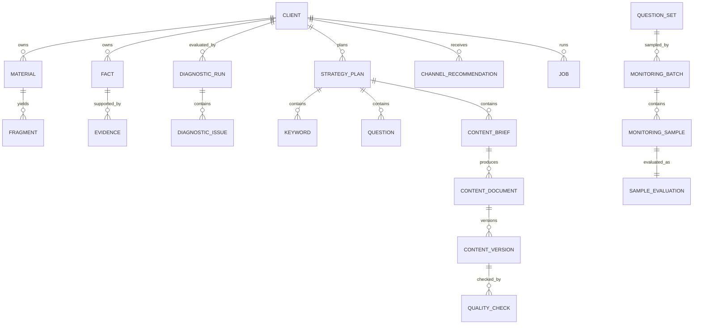

# 系统架构

Status: 阶段 C 定稿  
更新时间：2026-07-27

本文是工程视角的架构索引。产品范围、完整数据对象和用户验收以 `../PRD.md` 为准，HTTP 契约以 `../api-contracts.md` 为准，实施顺序以 `../Plan.md` 为准。

## 1. 上下文与质量目标

系统由一名平台负责人使用，为多个本地服务企业完成资料可信化、GEO 策略、内容生产、渠道建议和国内主流 AI 可见性监测。客户不登录，发布发生在系统外。

质量属性按以下顺序取舍：

1. 事实准确与客户数据隔离。
2. 可追溯、可解释和可恢复。
3. 内容工作效率与模型故障降级。
4. 单人可维护和低基础设施成本。
5. 在真实数据证明需要后再扩展吞吐。

## 2. 技术栈决策

| 层级 | 选择 |
|---|---|
| 前端 | Vue 3、TypeScript、Vite 8、Node.js 24 LTS、pnpm |
| 前端库 | Vue Router、Pinia、TanStack Query for Vue、Tiptap、Ant Design Vue |
| API | Python 3.13、FastAPI、Pydantic 2、SQLAlchemy 2、Alembic |
| 后台任务 | 与 API 共用领域包的独立 Worker，PostgreSQL 任务表 |
| 数据 | PostgreSQL 18 当前安全小版本、JSONB、`pg_trgm` |
| 文件 | 本地受保护文件适配器；PyMuPDF、python-docx、openpyxl、PaddleOCR |
| 模型 | 千问 `qwen3.7-plus` 主写；DeepSeek `deepseek-v4-pro` 独立复核；`deepseek-v4-flash` 降级 |
| 导出 | Markdown、DOCX |
| 测试 | Vitest、Vue Testing Library、Playwright、pytest、OpenAPI 契约测试 |
| 部署 | Docker Compose、Caddy、API、Worker、PostgreSQL、命名卷 |

采用模块化单体，不使用微服务、Redis、向量数据库、消息中间件、付费 OCR 或生产对象存储。

## 3. 组件边界

| 边界 | 拥有的数据 | 对外能力 |
|---|---|---|
| `auth` | 负责人账号、会话、登录审计 | 登录、退出、会话、密码 |
| `clients` | 客户、市场、工作台摘要 | 客户生命周期、当前客户 |
| `knowledge` | 客户资料、解析片段和企业知识条目 | 模板下载、上传解析、直接新增、编辑和内容上下文读取 |
| `strategy` | 诊断、问题、关键词、集群、计划、简报 | 诊断、策略生成、锁定、简报 |
| `content` | 事实快照、文档、版本、检查、变体、导出 | 生成、编辑、检查、自然化、导出 |
| `channels` | 渠道目录、客户渠道状态、推荐 | 目录查询、推荐计算 |
| `monitoring` | 平台、问题集、批次、样本、评估、指标、反馈 | API 采样、人工样本、评估、趋势 |
| `providers` | 模型配置引用、调用元数据、预算 | DeepSeek/Qwen 统一适配与降级 |
| `jobs` | 任务、尝试、事件 | 幂等创建、领取、进度、取消、重试 |
| `settings` | 模板、规则、非密钥配置、密钥引用 | 配置读写与连接测试 |
| `storage` | 文件元数据、哈希、受保护路径 | 写入、读取、下载、删除标记 |

控制器不得直接访问其他模块的数据表；跨模块通过应用服务和显式 DTO 调用。所有客户业务查询在仓储入口强制接收 `client_id`。

规范图：

- 系统与信任边界：`../diagrams/System-Context.md`
- 用户流程：`../diagrams/User-Flow.md`
- 核心业务：`../diagrams/Core-Logic.md`
- 状态模型：`../diagrams/State-Model.md`

## 4. 运行与部署

开发环境：

- Web 与 Python 服务可在 Windows 原生运行。
- PostgreSQL 18 在 Docker 容器运行。
- 文件保存到项目目录之外的本机受保护路径。
- 外部 Key 缺失时只启用与正式 DTO 一致的固定 Mock。

生产环境：

- 单台 Linux 主机运行 Docker Compose。
- Caddy 暴露 80/443，提供自动 TLS、静态资源和 `/api` 反向代理。
- API、Worker、PostgreSQL 只在私有容器网络通信。
- 数据库卷、文件卷、备份目录分离；数据库不开放公网端口。
- 每日加密备份保留 14 天，每周备份保留 8 周，备份复制到主机外存储。

容量基线：

- 100 个活跃客户。
- 每客户最多 5 GB 文件。
- 每日 300 个模型任务。
- API 普通读请求 P95 小于 800 ms；非模型写请求 P95 小于 1.5 秒。
- 后台任务创建响应小于 1 秒，单任务运行上限 20 分钟。

超过容量 70% 或任务队列连续 7 天 P95 等待超过 10 分钟时，先扩容主机，再评估托管数据库、对象存储或专用队列。

## 5. 数据模型

核心聚合：

数据规则：

- 主键使用 UUID；接口不暴露连续数据库编号。
- 时间按 UTC 保存，界面按 Asia/Shanghai 展示。
- 可编辑聚合具有整数 `version`，更新时做乐观锁。
- 客户、资料和内容采用可恢复归档；V1 无永久删除界面。
- 原始模型输出、结构化结果和人工修正分别保存。
- 内容版本不可变；恢复会生成新版本。
- API Key 只保存加密密文和掩码元数据，不进入普通业务 DTO。

## 6. API、任务与事件

- API 根路径为 `/api/v1`，只接受 HTTPS 生产流量。
- 认证使用服务端 Session Cookie；写请求必须携带 CSRF Token。
- 列表统一 `page/page_size`，最大 `page_size=100`。
- 幂等任务要求 `Idempotency-Key`，冲突更新使用 `version` 返回 409。
- 耗时动作返回 202 与 `job_id`；前端每 2 秒轮询 `GET /jobs/{job_id}`，离开页面不取消任务。
- Worker 通过 `FOR UPDATE SKIP LOCKED` 领取任务；超时任务由守护逻辑标记失败，只有显式重试才创建下一次尝试。
- V1 不发布外部 webhook。内部事件保存在 `job_events`，用于审计和排障，不作为公共集成契约。

## 7. 模型调用边界

默认流水线：

1. 千问 `qwen3.7-plus` 非思考模式完成候选事实、提纲和主稿。
2. DeepSeek `deepseek-v4-pro` 使用独立提示词复核事实、实体关系、合规和自然度。
3. 千问结构化输出启用 JSON 模式，服务端再执行 Pydantic Schema 校验。
4. 千问失败时用 `deepseek-v4-flash` 降级；DeepSeek Pro 失败时由千问使用复核模板降级。
5. 两个 Provider 均不可用时任务失败；只在明确的测试模式返回固定 Mock。

每次调用记录供应商、精确模型标识、模板版本、知识快照、输入/输出哈希、用量、时延、结果和降级原因。输入只包含当前客户知识库中与任务相关的最小必要信息；资料中的指令文本不作为系统指令执行。

## 8. 安全与隐私

- Argon2id 密码哈希；Session Cookie 使用 `HttpOnly`、`Secure`、`SameSite=Lax`。
- 写请求验证 CSRF；登录、模型任务、上传和导出各自限流。
- 上传校验扩展名、MIME、文件签名、大小和页数；允许 PDF、DOCX、XLSX、TXT、PNG、JPG。
- 单文件 30 MB，单次 20 个，压缩炸弹、超长 OCR 与宏文件拒绝处理。
- 模型密钥使用 `APP_MASTER_KEY` 包装加密；API 永不返回明文。
- 普通日志过滤授权头、Cookie、Secret、联系方式和客户原始内容。
- 未授权肖像、未成年人材料、案例和评价不得进入模型上下文或导出。
- 下载必须经过会话校验和客户归属校验，不提供长期公开 URL。

威胁重点：跨客户越权、上传恶意文件、提示词注入、模型数据泄露、密钥泄露、CSRF、暴力登录、导出越权和日志泄密。以上均纳入 `Test-Plan.md`。

## 9. 可观测性

- 每个请求生成 `request_id`，后台任务生成 `job_id`，模型调用生成 `model_call_id`。
- JSON 日志包含时间、级别、模块、请求/任务标识、耗时、状态和脱敏错误分类。
- 指标包含请求错误率、队列深度、任务等待/运行时长、Provider 成功率、降级率、Token 用量、客户存储量和备份结果。
- 健康检查分为进程存活 `/health/live` 与依赖就绪 `/health/ready`。
- 告警阈值：就绪检查连续失败 5 分钟、队列最老任务超过 20 分钟、模型日预算达到 80%、备份连续失败 1 次、磁盘使用达到 80%。

## 10. 迁移、备份与回滚

- 首次部署使用 Alembic 建表并写入版本化种子数据。
- Schema 变更先备份、再迁移；破坏性变更采用扩展—回填—切换—清理。
- 发布保留上一应用镜像与部署清单；出现阻断错误时停止新 Worker，回滚应用。
- 可逆迁移使用 Alembic downgrade；不可逆数据问题从部署前加密备份恢复。
- 恢复后核对客户、事实、文档版本、监测样本计数和文件哈希。
- 模型与提示词升级通过配置版本回退，不删除新旧产物。
- 恢复目标：RPO 24 小时，RTO 8 小时。

## 11. 外部依赖

| 依赖 | 所有者 | 运行缺失策略 |
|---|---|---|
| DeepSeek Key | 产品负责人 | 千问单模型降级；没有任一 Key 时真实模型任务不可用 |
| 百炼 Key 与北京工作空间 | 产品负责人 | DeepSeek 单模型降级；没有任一 Key 时真实模型任务不可用 |
| 消费者 AI 账号 | 使用者在系统外管理 | 人工样本可跳过该平台并记录失败 |
| PostgreSQL 与文件卷 | 项目部署 | 任一不可用时就绪检查失败 |
| 云主机、域名与主机外备份 | 产品负责人发布前授权 | 不影响本地开发，不执行生产部署 |

系统不接入自动发布 API、支付、短信、邮件、OAuth、搜索 API、地图 API 或云 OCR。

## 12. 架构决策记录

- `adr/ADR-0001-modular-monolith.md`
- `adr/ADR-0002-postgresql-job-queue.md`
- `adr/ADR-0003-evidence-bound-dual-model-pipeline.md`
- `adr/ADR-0004-single-host-compose-deployment.md`

这些选择在 V1 架构评审通过后生效。达到各 ADR 中的重评条件时，新增 ADR，不直接覆盖历史决定。
