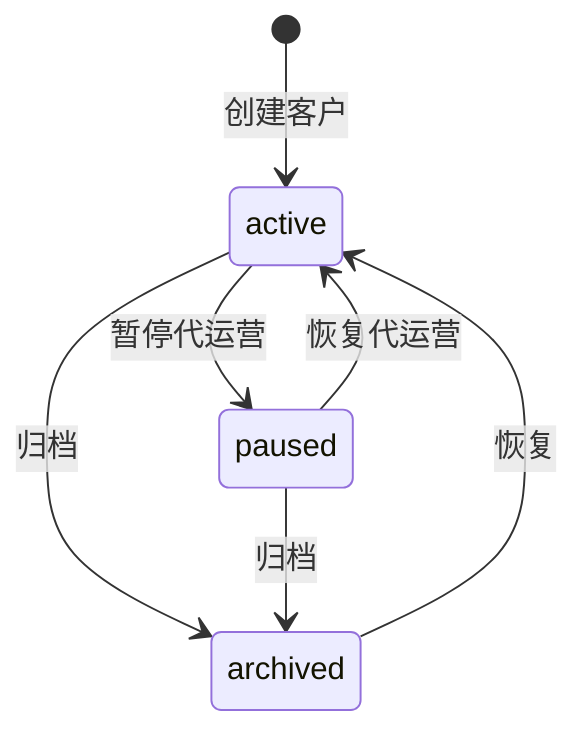
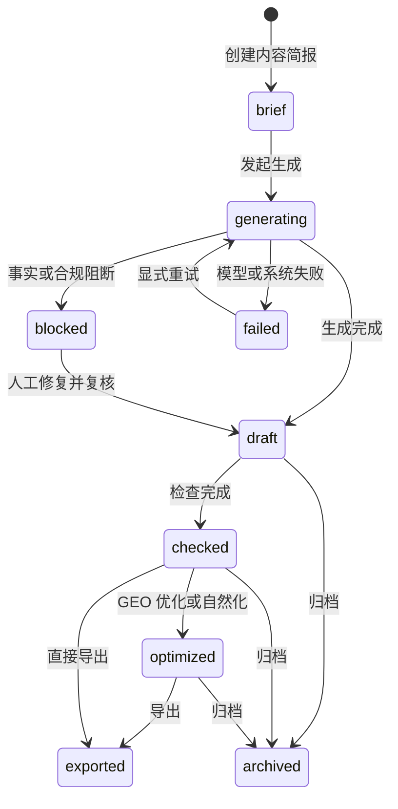
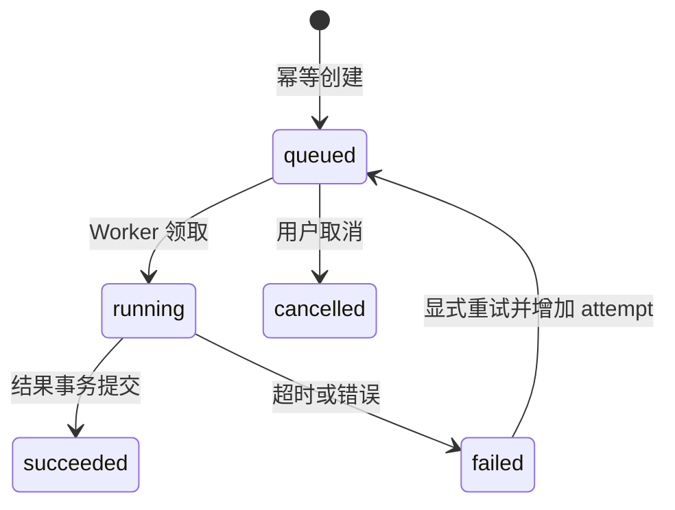

# 产品状态模型

Status: 阶段 C 定稿

## 客户

## 内容

## 后台任务

## 状态转换规则

| 对象 | 触发 | 前置条件 | 副作用 | 失败行为 |
|---|---|---|---|---|
| 客户 | 归档 | 无运行中任务 | 阻止新生成与监测，历史只读 | 有运行任务返回 409 |
| 内容 | 发起生成 | 简报存在、最小事实门槛通过 | 冻结事实快照并创建任务 | 事实不足返回 422 |
| 内容 | 优化/自然化 | 已有草稿 | 创建不可变新版本并再次事实检查 | 事实漂移时进入 blocked |
| 任务 | 领取 | `queued` 且重试时间已到 | 行锁更新为 `running` | 未获取锁则跳过 |
| 任务 | 重试 | `failed` 且未超过 3 次 | 创建新 attempt，保留历史错误 | 超过次数返回 409 |
| 监测批次 | 完成 | 所有样本成功或失败已落库 | 汇总指标并生成反馈候选 | 不把失败样本计为未提及 |
