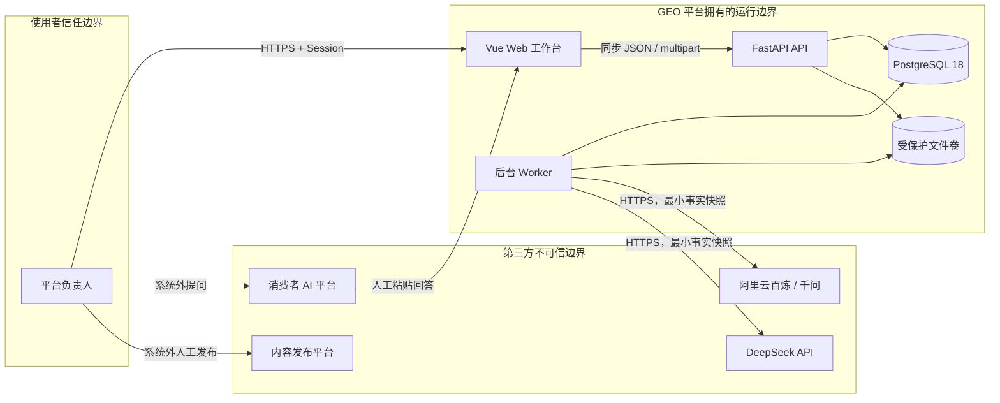

# 系统上下文与组件

Status: 阶段 C 定稿

## 边界说明

- 自有组件：Web、API、Worker、PostgreSQL、文件卷和备份脚本。
- 外部系统：DeepSeek、阿里云百炼、消费者 AI 产品、内容发布渠道。
- 敏感数据：客户资料、联系方式、未成年人素材、API Key、负责人会话和导出文件。
- 同步链路：浏览器到 API 的普通业务读写。
- 异步链路：文件解析、模型调用、诊断、内容生成、导出和 API 监测。
- 失败隔离：模型 Provider 失败不破坏已确认事实；消费者平台失败只影响对应样本；Worker 失败不影响页面读取。
- 数据所有权：项目数据库和文件卷是唯一业务权威源，第三方模型输出仅为候选结果。
